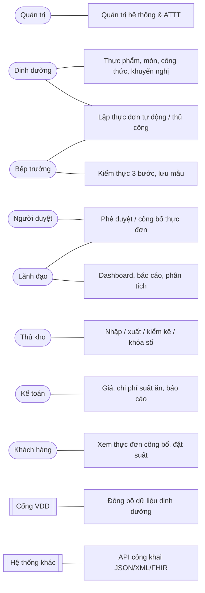

# ĐẶC TẢ YÊU CẦU PHẦN MỀM (SRS) — BlueMeal

**Phần mềm quản lý bữa ăn ca thông minh** · Phiên bản tài liệu 1.0 · Áp dụng cho BlueMeal v1.0.0

| Mục | Nội dung |
|---|---|
| Mục đích | Mô tả đầy đủ yêu cầu nghiệp vụ, tác nhân, use case, user story và tiêu chí chấp nhận làm căn cứ thiết kế, kiểm thử và nghiệm thu |
| Phạm vi | Lập và phê duyệt thực đơn bữa ăn ca cân đối dinh dưỡng; công thức món; tính dinh dưỡng và chi phí; kho và an toàn thực phẩm; báo cáo; tích hợp dữ liệu Viện Dinh dưỡng; quản trị và an toàn thông tin cấp độ 2 |
| Tài liệu liên quan | `02_ThietKe_HeThong.md`, `03_ThietKe_ATTT_CapDo2.md`, `04_KichBan_KiemThu.md`, `ASSUMPTIONS.md` |

## 1. Thuật ngữ

| Thuật ngữ | Giải thích |
|---|---|
| Bữa ăn ca | Bữa ăn cho người lao động theo ca làm việc (Ca 1 trưa, Ca 2 chiều, Ca 3 đêm, bữa phụ) |
| Đối tượng | Nhóm người ăn có cùng khuyến nghị dinh dưỡng (ví dụ: nam lao động vừa) |
| Khuyến nghị | Mục tiêu năng lượng/ngày, tỷ lệ năng lượng bữa, cơ cấu P:L:G, ngưỡng vi chất |
| P:L:G | Tỷ lệ năng lượng từ Protein : Lipid : Glucid |
| Cơ cấu bữa | Số món theo loại (cơm/tinh bột, món mặn, xào, canh, rau, tráng miệng…) |
| Snapshot | Bản lưu kết quả tính dinh dưỡng – chi phí – cảnh báo của thực đơn tại thời điểm tính |
| Kiểm thực 3 bước | Kiểm tra trước chế biến, trong chế biến, trước khi ăn (hướng dẫn Bộ Y tế) |
| FEFO | Hết hạn trước xuất trước |
| VDD | Viện Dinh dưỡng — cổng dữ liệu thành phần thực phẩm |

## 2. Tác nhân (Actor)

| Mã | Tác nhân | Mục tiêu chính |
|---|---|---|
| SYS_ADMIN | Quản trị hệ thống | Quản lý tài khoản, phân quyền, cấu hình, sao lưu, nhật ký, tích hợp |
| MANAGER | Lãnh đạo / quản lý | Theo dõi dashboard, báo cáo; duyệt thực đơn cấp cuối |
| MENU_APPROVER | Người duyệt thực đơn | Duyệt / trả lại / từ chối thực đơn dựa trên snapshot dinh dưỡng – chi phí |
| NUTRITIONIST | Cán bộ dinh dưỡng | Quản lý thực phẩm, khuyến nghị, món, công thức; lập thực đơn |
| HEAD_CHEF | Bếp trưởng | Lập thực đơn, công thức, kiểm thực 3 bước, lưu mẫu, đề xuất xuất kho |
| STOREKEEPER | Thủ kho | Nhập, xuất, kiểm kê kho (trong phạm vi kho được gán), kiểm tra chất lượng đầu vào |
| ACCOUNTANT | Kế toán | Giá nguyên liệu, chi phí suất ăn, báo cáo nhập-xuất-tồn và chi phí |
| CUSTOMER_REP | Đại diện đơn vị đặt suất | Xem thực đơn công bố của đơn vị mình, đặt/điều chỉnh số suất |
| Hệ thống ngoài | Cổng VDD; hệ thống khác dùng API công khai | Cung cấp dữ liệu dinh dưỡng; đọc thực đơn/dinh dưỡng đã công bố |
| Bộ lập lịch | Quartz.NET (worker) | Cảnh báo hằng ngày, đồng bộ VDD, xuất báo cáo nền, sao lưu bất thường, dọn dẹp |

## 3. Sơ đồ use case tổng quát

## 4. Yêu cầu chức năng

Quy ước tiêu chí chấp nhận: **AC-n** là điều kiện kiểm chứng được (tham chiếu test case ở `04_KichBan_KiemThu.md`).
Mọi màn hình danh mục có chung chức năng (**UC-CAT**): danh sách phân trang server-side, tìm kiếm không dấu, lọc, sắp xếp, thêm/sửa/xóa mềm,
khóa/mở, xem lịch sử thay đổi, nhập Excel theo mẫu (kiểm tra từng dòng, báo lỗi theo dòng, xem trước rồi mới ghi), xuất Excel.

### 4.0 Chức năng chung của danh mục (UC-CAT)

| User story | Là người dùng có quyền, tôi muốn tìm/nhập/xuất danh mục nhanh, an toàn |
|---|---|
| AC-1 | Danh sách phân trang phía server, tối đa 200 dòng/trang; sắp xếp theo cột cho phép |
| AC-2 | Tìm "ca ro phi" ra "Cá rô phi" (không dấu, không phân biệt hoa thường) |
| AC-3 | Xóa là xóa mềm; bản ghi đang được tham chiếu không xóa được (thông báo rõ) |
| AC-4 | Lịch sử thay đổi hiển thị người sửa, thời điểm, giá trị trước/sau |
| AC-5 | Nhập Excel: tải file mẫu có hướng dẫn; xem trước lỗi từng dòng; chỉ ghi các dòng hợp lệ khi người dùng xác nhận; file không phải Excel bị từ chối |
| AC-6 | Xuất Excel có tiêu đề đơn vị, tên danh mục, người lập, ngày lập; định dạng số Việt Nam |
| AC-7 | Xung đột chỉnh sửa đồng thời (2 người sửa cùng bản ghi) trả thông báo yêu cầu tải lại (HTTP 409) |

### 4.1 Quản trị hệ thống (SPEC §7.1)

| Mã | Chức năng | User story | Tiêu chí chấp nhận |
|---|---|---|---|
| UC-101 | Thông tin đơn vị | Là quản trị, tôi cập nhật tên, mã số thuế, địa chỉ, logo | AC: logo hiện trên header và báo cáo; chỉ ảnh PNG/JPEG/WEBP ≤ 2 MB (kiểm tra chữ ký nội dung file) |
| UC-102 | Cơ cấu tổ chức | Tôi quản lý cây phòng ban, kéo-thả sắp xếp | AC: kéo-thả đổi cha/thứ tự được lưu; không tạo vòng lặp cha-con |
| UC-103 | Danh mục chung | Tôi quản lý quốc gia, tỉnh/thành, xã/phường, đơn vị đo, quy đổi đơn vị | AC: UC-CAT; công cụ quy đổi giữa đơn vị cùng loại |
| UC-104 | Nhân viên | Tôi quản lý nhân viên và tạo tài khoản từ nhân viên | AC: SĐT/email/CCCD mã hóa khi lưu; người không có `pii.view` chỉ thấy giá trị che; tìm chính xác theo SĐT/CCCD vẫn được (hash); xuất dữ liệu cá nhân và ẩn danh hóa theo yêu cầu, có ghi nhật ký |
| UC-105 | Nhóm quyền | Tôi tạo nhóm quyền với ma trận module × hành động | AC: ma trận Xem/Thêm/Sửa/Xóa/Duyệt/Xuất/Nhập; thay đổi ghi audit `PermissionChange`; áp dụng ngay ở request kế tiếp |
| UC-106 | Tài khoản | Tôi thêm/sửa/khóa/mở, reset mật khẩu, gán nhóm quyền, phạm vi dữ liệu, bắt buộc MFA | AC: tài khoản mới phải đổi mật khẩu lần đầu; khóa tài khoản thu hồi mọi phiên; không xóa được quản trị cuối cùng |
| UC-107 | Phiên làm việc | Tôi xem ai đang đăng nhập và đăng xuất cưỡng bức | AC: hiện IP, thiết bị, thời gian đăng nhập/hoạt động gần nhất; thu hồi phiên có hiệu lực ngay |
| UC-108 | Danh sách chức năng | Tôi xem toàn bộ permission (chỉ đọc, song ngữ) | AC: sinh từ mã nguồn, không sửa được |
| UC-109 | Phân quyền hệ thống | Tôi quy định ai xem/sửa dữ liệu nào (permission + phạm vi kho/khách hàng) | AC: thủ kho chỉ thấy kho được gán; truy cập id ngoài phạm vi trả 404 |
| UC-110 | Phiên bản | Tôi xem phiên bản, build time, commit, changelog | AC: hiển thị đúng `CHANGELOG.md` |
| UC-111 | Đăng nhập / đăng xuất / quên mật khẩu | Là người dùng, tôi đăng nhập an toàn và tự lấy lại mật khẩu | AC: sai thông tin trả thông báo trung tính; khóa 15 phút sau 5 lần sai; CAPTCHA sau 3 lần sai; link quên mật khẩu dùng 1 lần, hết hạn 15 phút; MFA TOTP/mã khôi phục/OTP email |
| UC-112 | Hồ sơ cá nhân | Tôi đổi mật khẩu, bật MFA bằng QR, lấy 10 mã khôi phục, đổi ngôn ngữ, xem lịch sử đăng nhập | AC: mật khẩu theo chính sách và không trùng 5 mật khẩu gần nhất |
| UC-113 | Cấu hình hệ thống | Tôi cấu hình chính sách mật khẩu/phiên/MFA, ngưỡng cảnh báo, phương pháp giá kho, chi phí chung, SMTP, lịch sao lưu, lưu mẫu, trọng số tạo thực đơn | AC: giá trị được kiểm tra hợp lệ; thay đổi ghi audit `ConfigChange` |
| UC-114 | Sao lưu | Tôi xem lịch sử sao lưu, sao lưu bất thường, tải bản sao lưu | AC: tải phải nhập lại mật khẩu + MFA; bản sao lưu mã hóa AES-256, có SHA-256 |
| UC-115 | Nhật ký hệ thống | Tôi tra cứu nhật ký theo người, hành động, đối tượng, thời gian, xuất Excel | AC: nhật ký không sửa/xóa được qua ứng dụng; lưu ≥ 12 tháng |
| UC-116 | Dữ liệu mẫu | Tôi nạp/xóa bộ dữ liệu mẫu để demo, đào tạo | AC: dữ liệu mẫu được gắn nhãn; xóa không ảnh hưởng dữ liệu thật |

### 4.2 Đối tượng, đối tác, khách hàng (SPEC §7.2)

| Mã | Chức năng | Tiêu chí chấp nhận |
|---|---|---|
| UC-201 | Đối tượng | UC-CAT; gắn khuyến nghị mặc định; mức lao động, giới tính, tuổi |
| UC-202 | Loại đối tác / Đối tác | UC-CAT; tab Hợp đồng (giá theo nguyên liệu, hiệu lực), Giấy chứng nhận ATTP (upload PDF/ảnh, ngày hết hạn → cảnh báo), Lịch sử nhập hàng, Đánh giá |
| UC-203 | Loại khách hàng / Khách hàng | UC-CAT; tab Liên hệ, Đơn giá suất ăn (theo ca/đối tượng, hiệu lực), Đặt suất, Thực đơn công bố; CUSTOMER_REP chỉ thấy đơn vị mình |

### 4.3 Thực phẩm, món ăn, công thức (SPEC §7.3)

| Mã | Chức năng | Tiêu chí chấp nhận |
|---|---|---|
| UC-301 | Kho | UC-CAT; loại kho, nhiệt độ bảo quản, thủ kho phụ trách |
| UC-302 | Nhóm thực phẩm | Cây nhóm; cờ nguồn động vật (tính tỷ lệ đạm động vật) |
| UC-303 | Thực phẩm | Lưới giá trị dinh dưỡng/100 g sửa nhanh; tỷ lệ thải bỏ; nguồn và phiên bản dữ liệu; dữ liệu từ VDD khóa sửa mặc định (mở khóa cần `food.unlock`); nút "Đồng bộ từ Viện Dinh dưỡng"; nhập 500 thực phẩm từ Excel < 30 giây |
| UC-304 | ATTP & chất lượng | Tiêu chuẩn cảm quan, nhiệt độ bảo quản, giấy tờ yêu cầu theo thực phẩm/nguyên liệu |
| UC-305 | Nguyên liệu | Ánh xạ thực phẩm (combobox không dấu), đơn vị mua, quy đổi gram, giá tham chiếu, lịch sử giá, tồn hiện tại, tồn tối thiểu, mã vạch |
| UC-306 | Món ăn | Ảnh, loại món, phương pháp chế biến; xem nhanh dinh dưỡng và chi phí 1 suất |
| UC-307 | Công thức | Thêm nguyên liệu, khối lượng sống → tự tính khối lượng sạch; dinh dưỡng, chi phí, P:L:G **realtime**; phiên bản (tạo mới, so sánh 2 bản, kích hoạt); nhân bản; quy đổi theo số suất; cảnh báo rời trang chưa lưu |
| UC-308 | Khuyến nghị | Mục tiêu năng lượng/ngày, tỷ lệ bữa, P:L:G, đạm động vật, ngưỡng từng chất (min/max/bữa, mức cảnh báo); gắn đối tượng |
| UC-309 | Nhóm báo cáo | Gán 16 báo cáo vào nhóm; quyền xem theo nhóm |

Quy tắc tính toán (SPEC §6): năng lượng/chất theo khối lượng ăn được × hệ số giữ lại theo phương pháp chế biến; làm tròn hiển thị (năng lượng 0, đa lượng 1, vi lượng 2 chữ số);
chi phí = Σ khối lượng mua × đơn giá theo cấu hình (tham chiếu / lần nhập gần nhất / bình quân gia quyền / hợp đồng) + chi phí chung (% hoặc cố định/suất).

### 4.4 Thực đơn (SPEC §7.4, §6.4)

| Mã | Chức năng | User story | Tiêu chí chấp nhận |
|---|---|---|---|
| UC-401 | Kế hoạch thực đơn | Là cán bộ dinh dưỡng, tôi lập kế hoạch tuần/tháng trên lịch | AC: lịch ngày × ca, màu theo trạng thái; kéo-thả món giữa ngày (chỉ thực đơn Nháp/Trả lại); nhân bản tuần; áp dụng cho nhiều khách hàng |
| UC-402 | Danh sách thực đơn | Tôi xem lại và lọc thực đơn | AC: lọc ngày, ca, đối tượng, khách hàng, trạng thái; chi tiết; sao chép; in; người không có quyền chi phí không thấy chi phí |
| UC-403 | Tạo tự động | Tôi muốn hệ thống đề xuất thực đơn cân đối | AC: tham số khoảng ngày, ca, đối tượng/khuyến nghị, cơ cấu, ngân sách, không lặp món N ngày, món bắt buộc/loại trừ, dị ứng, ưu tiên hàng sắp hết hạn, tỷ lệ món mới, seed; mỗi ngày có phương án tốt nhất + 2 phương án thay thế, giải thích lý do; cùng seed cho cùng kết quả; sinh 1 tháng < 5 giây; tối đa 1 món chiên/bữa |
| UC-404 | Tạo thủ công | Tôi chọn món theo slot và thấy ngay chỉ tiêu | AC: panel realtime năng lượng, P/L/G, % đáp ứng, chi phí/suất, cảnh báo màu (kèm biểu tượng và chữ); gợi ý top 5 món thay thế làm điểm tốt hơn |
| UC-405 | Phê duyệt | Là người duyệt, tôi duyệt dựa trên snapshot | AC: luồng Nháp → Chờ duyệt → (Đã duyệt / Từ chối / Trả lại) → Công bố → (Hủy); 1 hoặc 2 cấp; duyệt hàng loạt; bắt buộc ý kiến khi từ chối/trả lại; cảnh báo nghiêm trọng cần lý do và quyền `menu.override_critical`; thực đơn đã duyệt bị khóa, muốn sửa phải Thu hồi (quyền + lý do, ghi audit); thông báo cho người duyệt và người lập |
| UC-406 | Công bố | Người lao động/khách hàng xem thực đơn tuần | AC: responsive, in A4; chỉ món và năng lượng, không chi phí |
| UC-407 | Đặt suất ăn | Khách hàng/admin nhập số suất theo ngày, ca | AC: tổng hợp theo ngày × ca; cập nhật số suất vào thực đơn; khách hàng chỉ thao tác đơn vị mình |

Chỉ thực đơn **Đã duyệt/Công bố** được dùng để sinh phiếu xuất và đề xuất mua (UC-602, UC-605).

### 4.5 Phân tích dinh dưỡng (SPEC §7.5)

| Mã | Tiêu chí chấp nhận |
|---|---|
| UC-501 | Phân tích cho 1 món / 1 thực đơn / khoảng ngày: bảng đầy đủ chất dinh dưỡng, % đáp ứng (thanh màu + biểu tượng), biểu đồ P:L:G, biểu đồ vi chất, xu hướng năng lượng theo ngày, trung bình tuần/tháng |
| UC-502 | So sánh 2 thực đơn hoặc 2 đối tượng cạnh nhau |
| UC-503 | Xuất Excel bảng phân tích |

### 4.6 Cảnh báo chỉ tiêu (SPEC §7.6, §6.2)

| Mã | Tiêu chí chấp nhận |
|---|---|
| UC-511 | Cảnh báo hiển thị inline trong thực đơn và công thức: năng lượng thấp/cao, P:L:G ngoài khoảng, đạm động vật, vi chất dưới min/trên max, vượt ngân sách, lặp món, thiếu cơ cấu, thiếu dữ liệu, dị ứng, thiếu tồn kho |
| UC-512 | Trung tâm cảnh báo `/alerts`: lọc mức/loại/trạng thái; tiếp nhận; đánh dấu đã xử lý kèm ghi chú; job hằng ngày tạo cảnh báo hết hạn giấy chứng nhận, lô hàng sắp hết hạn, tồn dưới tối thiểu, mẫu lưu đến hạn hủy — không trùng lặp, tự đóng khi hết điều kiện |
| UC-513 | Chuông thông báo trên header |
| UC-514 | Màn hình cấu hình ngưỡng (quyền `alert.config`) |

### 4.7 Chi phí suất ăn (SPEC §7.7)

| Mã | Tiêu chí chấp nhận |
|---|---|
| UC-521 | Chi phí realtime trong công thức và thực đơn |
| UC-522 | Bảng tính chi phí theo ngày/tuần/tháng × khách hàng: số suất, chi phí kế hoạch, chi phí thực tế (phiếu xuất đã ghi sổ + chi phí chung), doanh thu theo đơn giá thỏa thuận, chênh lệch, lãi gộp |
| UC-523 | Cấu hình chi phí chung (overhead) |

### 4.8 Kho và an toàn thực phẩm (SPEC §7.8, §5.5, §5.6, §6.5)

| Mã | Chức năng | Tiêu chí chấp nhận |
|---|---|---|
| UC-601 | Phiếu nhập | Tạo thủ công hoặc từ đề xuất mua; mỗi dòng: số lượng, đơn giá, lô, NSX, HSD, kết quả kiểm tra chất lượng, nhiệt độ; nhập mã vạch; dòng Không đạt chặn ghi sổ; ghi sổ tự lập biên bản kiểm thực bước 1; in phiếu; Idempotency-Key chống tạo trùng |
| UC-602 | Phiếu xuất | Thủ công, chuyển kho, hoặc sinh phiếu dự kiến từ thực đơn đã duyệt (định lượng × số suất, lô FEFO); đơn giá xuất theo bình quân gia quyền di động (mặc định) hoặc FIFO; không xuất âm (cấu hình được) |
| UC-603 | Kiểm kê | Tạo phiên chụp tồn sổ sách theo lô; nhập số thực tế trên điện thoại; duyệt tự sinh và ghi sổ phiếu điều chỉnh |
| UC-604 | Tồn kho, thẻ kho | Tồn hiện tại và tại một ngày; thẻ kho có tồn đầu, phát sinh, tồn cuối; danh sách lô sắp hết hạn; cảnh báo dưới tối thiểu |
| UC-605 | Đề xuất mua | Sinh từ thực đơn đã duyệt: `max(0, nhu cầu − tồn khả dụng + tồn tối thiểu)`; duyệt; tạo phiếu nhập theo nhà cung cấp |
| UC-606 | Khóa sổ | Khóa theo tháng (cả các tháng trước); không ghi chứng từ vào kỳ đã khóa |
| UC-607 | Kiểm thực 3 bước | Bước 1 trước chế biến, bước 2 trong chế biến, bước 3 trước khi ăn; tiêu chí cấu hình được; Không đạt phải ghi biện pháp xử lý; in biểu mẫu |
| UC-608 | Lưu mẫu | Lấy mẫu theo món/thực đơn; hủy dự kiến ≥ 24 giờ (cấu hình); khối lượng tối thiểu; không hủy trước hạn; in sổ |

### 4.9 Báo cáo và dashboard (SPEC §7.9)

UC-701 — 16 báo cáo RPT-01…RPT-16 (danh sách tại `02_ThietKe_HeThong.md` mục 6.2). Tiêu chí chung: bộ lọc theo báo cáo (khoảng ngày, kho, khách hàng, đối tượng, nhóm thực phẩm…),
xem trên web, **xuất Excel** có tiêu đề đơn vị, tên báo cáo, kỳ, người lập, ngày lập, chữ ký, định dạng số Việt Nam; lưu bộ lọc yêu thích; báo cáo lớn (> 3.000 dòng) chạy nền và báo khi xong; tôn trọng quyền và phạm vi dữ liệu.

UC-702 — Dashboard theo vai trò: thực đơn chờ duyệt, cảnh báo nghiêm trọng, số suất hôm nay, chi phí/suất tuần so với ngân sách, % đáp ứng năng lượng 7 ngày, hàng sắp hết hạn, mẫu lưu cần hủy.

### 4.10 Tích hợp (SPEC §7.10)

| Mã | Tiêu chí chấp nhận |
|---|---|
| UC-801 | Cấu hình kết nối VDD: URL, xác thực (API key / Basic / OAuth2 client credentials), credential mã hóa (không hiển thị lại), timeout, lịch, mapping JSON; kiểm tra kết nối |
| UC-802 | Đồng bộ theo lịch (02:00) và thủ công; tăng dần theo `modifiedSince`; upsert theo mã; quy đổi đơn vị theo mapping; retry khi lỗi tạm thời |
| UC-803 | Xung đột: bản ghi đã sửa tay mà nguồn cũng đổi → danh sách xung đột so sánh từng trường; chọn giữ bản đang dùng hoặc lấy dữ liệu nguồn |
| UC-804 | Lịch sử đồng bộ: thời điểm, số bản ghi nhận/tạo/cập nhật/xung đột, chi tiết từng request, lỗi |
| UC-805 | API công khai `/api/v1/public/*`: token client credentials, scope; JSON hoặc XML; FHIR R4 tối giản; tài liệu OpenAPI |

## 5. Yêu cầu phi chức năng

| Mã | Yêu cầu | Tiêu chí |
|---|---|---|
| NFR-01 | Hiệu năng | ≥ 1.000 người dùng đồng thời; p95 truy vấn đọc < 1 giây; tỷ lệ lỗi < 1 % (k6, `docs/test-reports/k6-load-test.html`) |
| NFR-02 | Bảo mật | ATTT cấp độ 2 — `03_ThietKe_ATTT_CapDo2.md`; ZAP baseline không có High/Medium |
| NFR-03 | Ngôn ngữ | Song ngữ Việt/Anh toàn bộ giao diện, thông báo lỗi, báo cáo; mặc định tiếng Việt; không thiếu key giữa hai ngôn ngữ |
| NFR-04 | Tương thích | Chrome, Cốc Cốc, Edge, Safari (2 phiên bản gần nhất); Windows, Linux, macOS, iOS, Android |
| NFR-05 | Responsive | Các màn kho, kiểm thực, lưu mẫu, xem/duyệt thực đơn dùng tốt trên điện thoại ≥ 360 px; dark mode |
| NFR-06 | Khả năng truy cập | Lighthouse Accessibility/Best Practices/Performance ≥ 85 trên các trang chính |
| NFR-07 | Định dạng | Số và tiền kiểu Việt Nam (`1.234.567 ₫`), ngày `dd/MM/yyyy`, múi giờ Asia/Ho_Chi_Minh |
| NFR-08 | Triển khai | Docker Compose trên máy chủ của chủ đầu tư, có gói cài đặt offline; không phụ thuộc dịch vụ SaaS, không telemetry |
| NFR-09 | Giấy phép | Chỉ dùng thư viện MIT/Apache/BSD/PostgreSQL (`THIRD_PARTY_LICENSES.md`) |
| NFR-10 | Sao lưu | Hằng ngày 01:00, giữ 7/4/6; sao lưu bất thường; diễn tập khôi phục tự động |

## 6. Ràng buộc và giả định

Các giả định đã thống nhất được ghi tại `ASSUMPTIONS.md` (A-01 … A-44), ví dụ: hợp đồng API VDD giả định (A-25), API công khai (A-26), khóa sổ (A-39),
chặn ghi sổ khi kiểm tra chất lượng Không đạt (A-40), đơn vị kho (A-41), Idempotency-Key (A-42), phạm vi FHIR (A-43), Quartz.NET thay Hangfire (A-34).

## 7. Truy vết

Ma trận truy vết yêu cầu ↔ test case nằm ở `04_KichBan_KiemThu.md` mục 2; checklist nghiệm thu đối chiếu Chương V E-HSMT ở mục cuối của tài liệu đó.
