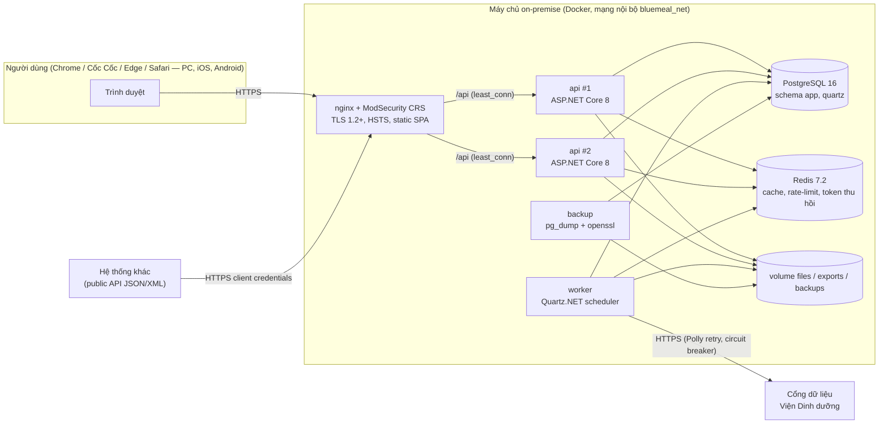
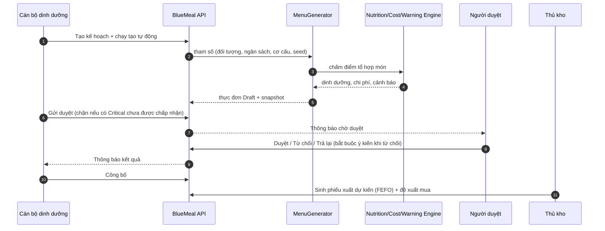
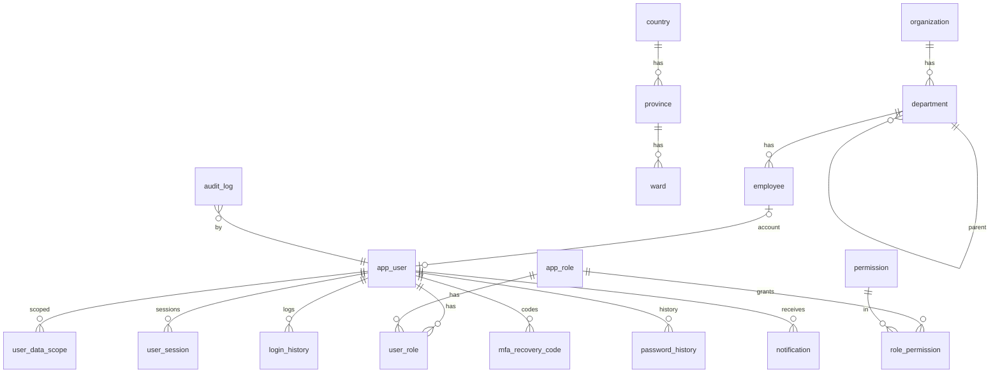
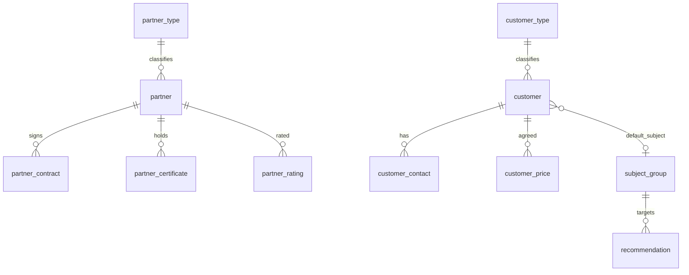
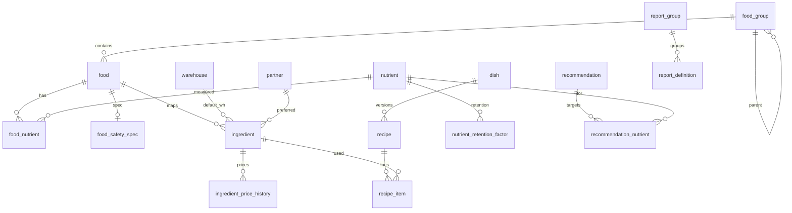
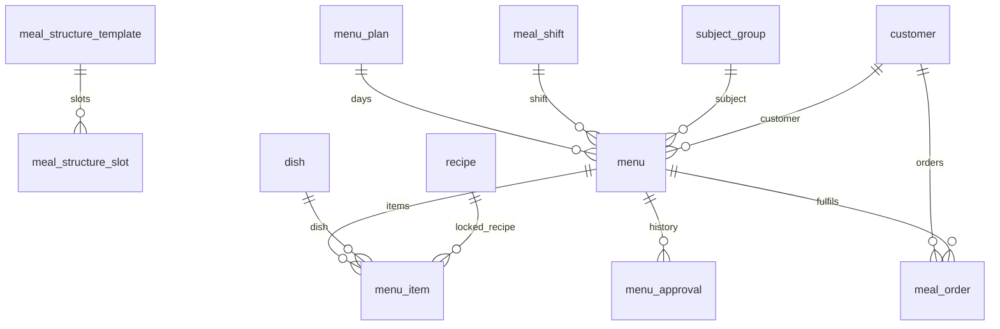
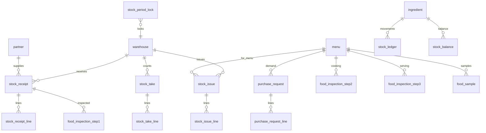
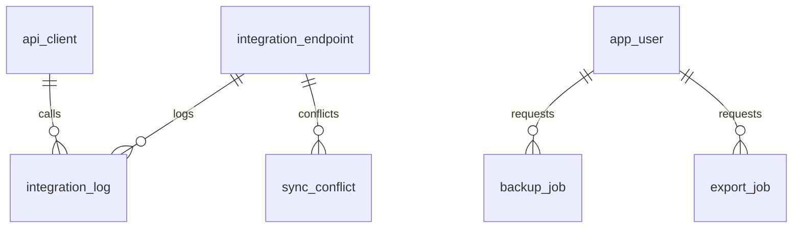

# THIẾT KẾ HỆ THỐNG — BlueMeal

*Phần mềm quản lý bữa ăn ca thông minh — Gói thầu IB2600574672 — Viện Dinh dưỡng (Bộ Y tế)*

| Thuộc tính | Giá trị |
|---|---|
| Phiên bản tài liệu | 1.0 |
| Căn cứ | `SPEC.md`, `docs/ASSUMPTIONS.md` |

## 1. Kiến trúc tổng thể

### 1.1 Phân lớp backend (Clean Architecture)

| Lớp | Nội dung | Phụ thuộc |
|---|---|---|
| `BlueMeal.Domain` | Entity, enum, value object, quy tắc nghiệp vụ thuần | — |
| `BlueMeal.Application` | DTO, validator, interface (`IAppDbContext`, `INutritionDataProvider`, `ICurrentUser`…), các engine: `NutritionEngine`, `WarningEngine`, `CostEngine`, `MenuGenerator`, `InventoryEngine` | Domain |
| `BlueMeal.Infrastructure` | EF Core + Npgsql, interceptor audit/soft-delete, mã hóa cột AES-GCM, Redis, Quartz.NET job, ClosedXML, VDD API client, email SMTP, lưu file | Application |
| `BlueMeal.Api` | Controller, middleware (ProblemDetails, audit, idempotency, security headers), xác thực JWT, phân quyền, rate limit, Swagger, health check | Infrastructure |

Engine tính toán viết thuần C# với input là các record bất biến → kiểm thử đơn vị độc lập DB.

### 1.2 Frontend

React 18 + TypeScript + Vite, Ant Design 5. Tổ chức theo `features/<module>`; `shared/` chứa `CatalogPage` (màn hình danh mục generic), `PermissionGuard`, định dạng số/tiền/ngày kiểu Việt Nam. Access token chỉ trong bộ nhớ (Zustand), refresh token trong cookie HttpOnly.

## 2. Phân hệ

| Phân hệ | Chức năng chính | Mục SPEC |
|---|---|---|
| Quản trị hệ thống | Đơn vị, cơ cấu tổ chức, danh mục chung, nhân viên, nhóm quyền, tài khoản, phiên, chức năng, phiên bản, cấu hình, sao lưu, nhật ký | 7.1, 10 |
| Đối tượng – Đối tác – Khách hàng | Đối tượng lao động, nhà cung cấp (hợp đồng, giấy chứng nhận), khách hàng (liên hệ, đơn giá, đặt suất) | 7.2 |
| Thực phẩm – Món ăn | Kho, nhóm TP, chất dinh dưỡng, thực phẩm, ATTP, nguyên liệu, món, công thức, khuyến nghị, nhóm báo cáo | 7.3 |
| Thực đơn | Kế hoạch, lịch, tạo tự động/thủ công, duyệt, công bố, đặt suất | 7.4 |
| Dinh dưỡng – Cảnh báo – Chi phí | Phân tích, so sánh, trung tâm cảnh báo, bảng tính chi phí | 7.5–7.7 |
| Kho – ATTP | Nhập, xuất, kiểm kê, thẻ kho, khóa sổ, kiểm thực 3 bước, lưu mẫu | 7.8, 5.6 |
| Báo cáo | 16 báo cáo + dashboard | 7.9 |
| Tích hợp | Đồng bộ VDD, xung đột, public API, XML, FHIR tối giản | 7.10 |

## 3. Luồng dữ liệu chính

## 4. Mô hình dữ liệu (ERD)

Toàn bộ bảng nằm trong schema `app`, tên `snake_case`. Cột chung: `id uuid`, `created_at`, `created_by`, `updated_at`, `updated_by`, `is_deleted`, `xmin` (concurrency). Danh mục thêm `code` (unique trong các bản ghi chưa xóa), `name_vi`, `name_en`, `is_active`, `sort_order`, `search_text`.

### 4.1 Quản trị hệ thống

### 4.2 Đối tượng – đối tác – khách hàng

### 4.3 Thực phẩm – món ăn – công thức

### 4.4 Thực đơn

### 4.5 Kho và ATTP

### 4.6 Tích hợp – vận hành

## 5. Thiết kế API

- Prefix `/api/v1`, JSON camelCase, ISO-8601 có offset.
- Phân trang `?page=&pageSize=&sort=&q=` → `{ items, page, pageSize, totalItems }`, `pageSize ≤ 200`.
- Lỗi RFC 7807 (`application/problem+json`) có `traceId`, `errors`; thông điệp theo `Accept-Language`.
- Concurrency: DTO có `version` (xmin), xung đột → 409.
- `Idempotency-Key` cho POST tạo phiếu kho (lưu Redis 24h).
- Mọi endpoint gắn `[HasPermission]` hoặc `[AllowAnonymous]` tường minh; fallback policy deny.
- OpenAPI xuất `docs/api/openapi.json`.

Danh sách nhóm endpoint chi tiết: xem `docs/api/openapi.json` (sinh tự động).

## 6. Thiết kế giao diện

Danh sách màn hình sẽ hoàn thiện ở Phase P10 (mục 7 của tài liệu này).

## 7. Triển khai

Xem `docs/05_HuongDan_CaiDat.md`. Môi trường: Docker Compose (`deploy/docker-compose.yml` + `.dev.yml` / `.prod.yml`).
