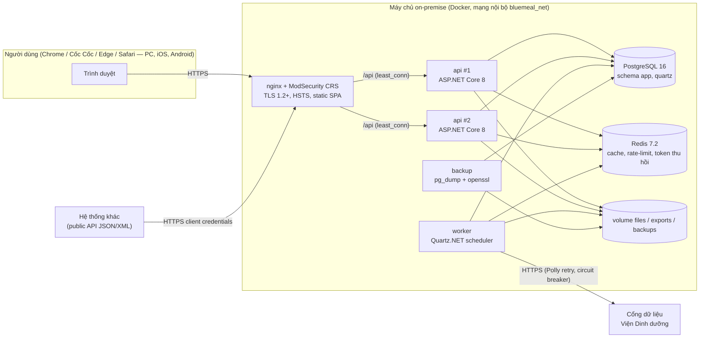
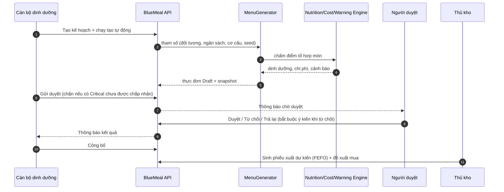
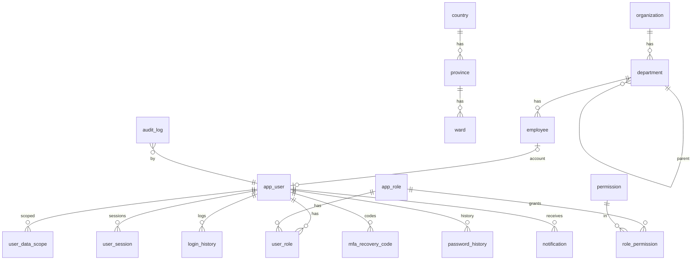
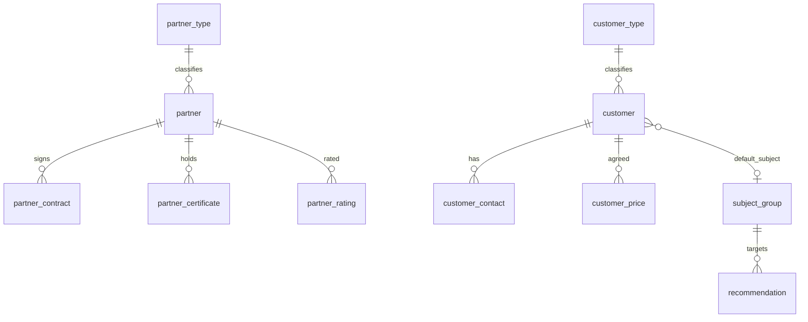
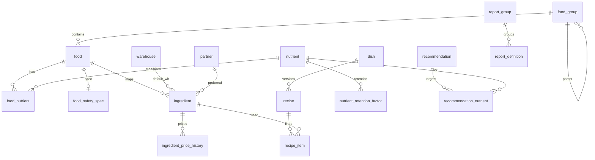
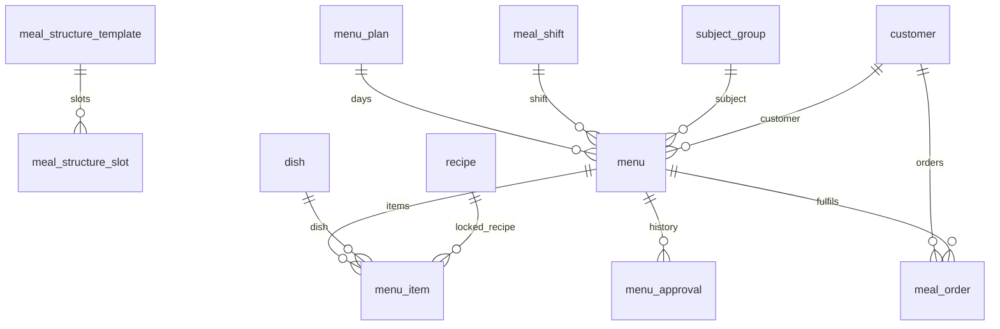
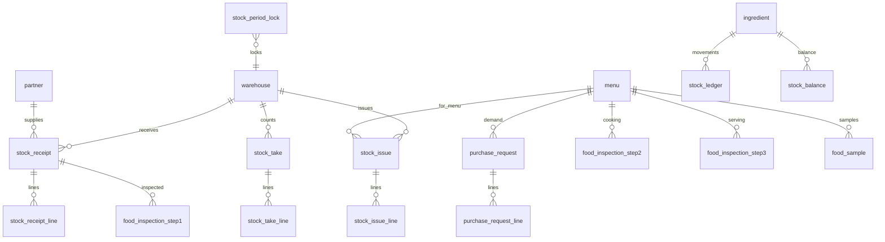
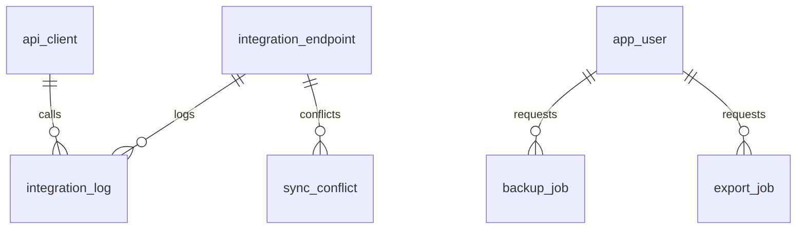

# THIẾT KẾ HỆ THỐNG — BlueMeal

*Phần mềm quản lý bữa ăn ca thông minh — Gói thầu IB2600574672 — Viện Dinh dưỡng (Bộ Y tế)*

| Thuộc tính | Giá trị |
|---|---|
| Phiên bản tài liệu | 1.0 (khớp BlueMeal v1.0.0) |
| Căn cứ | `SPEC.md`, `docs/ASSUMPTIONS.md` |

## 1. Kiến trúc tổng thể

### 1.1 Phân lớp backend (Clean Architecture)

| Lớp | Nội dung | Phụ thuộc |
|---|---|---|
| `BlueMeal.Domain` | Entity, enum, value object, quy tắc nghiệp vụ thuần | — |
| `BlueMeal.Application` | DTO, validator, interface (`IAppDbContext`, `INutritionDataProvider`, `ICurrentUser`…), các engine: `NutritionEngine`, `WarningEngine`, `CostEngine`, `MenuGenerator`, `InventoryEngine` | Domain |
| `BlueMeal.Infrastructure` | EF Core + Npgsql, interceptor audit/soft-delete, mã hóa cột AES-GCM, Redis, Quartz.NET job, ClosedXML, VDD API client, email SMTP, lưu file | Application |
| `BlueMeal.Api` | Controller, middleware (ProblemDetails, audit, idempotency, security headers), xác thực JWT, phân quyền, rate limit, Swagger, health check | Infrastructure |

Engine tính toán viết thuần C# với input là các record bất biến → kiểm thử đơn vị độc lập DB.

### 1.2 Frontend

React 18 + TypeScript + Vite, Ant Design 5. Tổ chức theo `features/<module>`; `shared/` chứa `CatalogPage` (màn hình danh mục generic), `PermissionGuard`, định dạng số/tiền/ngày kiểu Việt Nam. Access token chỉ trong bộ nhớ (Zustand), refresh token trong cookie HttpOnly.

## 2. Phân hệ

| Phân hệ | Chức năng chính | Mục SPEC |
|---|---|---|
| Quản trị hệ thống | Đơn vị, cơ cấu tổ chức, danh mục chung, nhân viên, nhóm quyền, tài khoản, phiên, chức năng, phiên bản, cấu hình, sao lưu, nhật ký | 7.1, 10 |
| Đối tượng – Đối tác – Khách hàng | Đối tượng lao động, nhà cung cấp (hợp đồng, giấy chứng nhận), khách hàng (liên hệ, đơn giá, đặt suất) | 7.2 |
| Thực phẩm – Món ăn | Kho, nhóm TP, chất dinh dưỡng, thực phẩm, ATTP, nguyên liệu, món, công thức, khuyến nghị, nhóm báo cáo | 7.3 |
| Thực đơn | Kế hoạch, lịch, tạo tự động/thủ công, duyệt, công bố, đặt suất | 7.4 |
| Dinh dưỡng – Cảnh báo – Chi phí | Phân tích, so sánh, trung tâm cảnh báo, bảng tính chi phí | 7.5–7.7 |
| Kho – ATTP | Nhập, xuất, kiểm kê, thẻ kho, khóa sổ, kiểm thực 3 bước, lưu mẫu | 7.8, 5.6 |
| Báo cáo | 16 báo cáo + dashboard | 7.9 |
| Tích hợp | Đồng bộ VDD, xung đột, public API, XML, FHIR tối giản | 7.10 |

## 3. Luồng dữ liệu chính

## 4. Mô hình dữ liệu (ERD)

Toàn bộ bảng nằm trong schema `app`, tên `snake_case`. Cột chung: `id uuid`, `created_at`, `created_by`, `updated_at`, `updated_by`, `is_deleted`, `xmin` (concurrency). Danh mục thêm `code` (unique trong các bản ghi chưa xóa), `name_vi`, `name_en`, `is_active`, `sort_order`, `search_text`.

### 4.1 Quản trị hệ thống

### 4.2 Đối tượng – đối tác – khách hàng

### 4.3 Thực phẩm – món ăn – công thức

### 4.4 Thực đơn

### 4.5 Kho và ATTP

### 4.6 Tích hợp – vận hành

## 5. Thiết kế API

### 5.1 Quy ước

- Prefix `/api/v1`, JSON camelCase, ISO-8601 có offset (múi giờ Asia/Ho_Chi_Minh); XML khi `Accept: application/xml` (API công khai).
- Phân trang `?page=&pageSize=&sort=&q=` → `{ items, page, pageSize, totalItems }`, `pageSize ≤ 200`.
- Lỗi RFC 7807 (`application/problem+json`) có `traceId`, `code`, `errors` theo field; thông điệp song ngữ theo `Accept-Language`.
- Kiểm soát đồng thời: DTO có `version` (xmin) → xung đột 409.
- `Idempotency-Key` cho POST tạo/ghi sổ chứng từ kho, đề xuất mua (lưu kết quả 24 giờ).
- Mọi endpoint gắn `[HasPermission]`, `[PublicScope]` (API công khai) hoặc `[AllowAnonymous]` tường minh; endpoint không khai báo → 403 (deny by default, có test quét toàn bộ controller).
- Không trả entity trực tiếp, chỉ DTO; tài liệu OpenAPI sinh tự động `docs/api/openapi.json`.

### 5.2 Nhóm endpoint

| Nhóm | Đường dẫn chính | Ghi chú |
|---|---|---|
| Xác thực | `/auth/login`, `/auth/mfa/verify`, `/auth/refresh`, `/auth/logout`, `/auth/forgot-password`, `/auth/reset-password`, `/auth/captcha` | Refresh token cookie HttpOnly + CSRF header |
| Hồ sơ | `/profile/*` (mật khẩu, MFA, phiên, lịch sử đăng nhập, tùy chọn giao diện) | |
| Quản trị | `/organization`, `/departments`, `/employees`, `/roles`, `/permissions`, `/users`, `/sessions`, `/settings/{key}`, `/audit-logs`, `/files`, `/system/*`, `/system/sample-data`, `/backups` | |
| Danh mục | `/countries`, `/provinces`, `/wards`, `/units`, `/subject-groups`, `/partner-types`, `/partners`, `/customer-types`, `/customers`, `/warehouses`, `/food-groups`, `/nutrients`, `/foods`, `/food-safety-specs`, `/ingredients`, `/dishes`, `/recipes`, `/recommendations`, `/report-groups`, `/meal-shifts`, `/meal-structures` | Chung: `GET` danh sách/chi tiết/`lookup`, `POST/PUT/DELETE`, `lock/unlock`, `history`, `import/template`, `import/preview`, `import/commit`, `export` |
| Thực đơn | `/menu-plans` (+`calendar`, `copy-week`, `apply-customers`), `/menus` (+`compute`, `generate`, `submit/approve/reject/return/publish/cancel/recall`, `bulk`, `move-item`, `suggestions`, `published`), `/meal-orders` (+`summary`, `apply-to-menus`) | |
| Kho | `/stock-receipts`, `/stock-issues` (+`from-menu`, `suggest-lots`), `/stock-takes` (+`approve`), `/stock/balances`, `/stock/card`, `/stock/lots`, `/stock/period-locks`, `/purchase-requests` (+`generate`, `approve`, `receipts`) | `{id}/post` ghi sổ |
| ATTP | `/inspections/step1|step2|step3`, `/inspections/form`, `/inspections/day-dishes`, `/food-samples` (+`dispose`, `rules`) | |
| Phân tích – báo cáo | `/analysis/nutrition` (+`export`), `/cost-sheet`, `/dashboard`, `/alerts` (+`resolve`, `run-daily`, `config`), `/reports` (+`{code}/run`, `{code}/export`, `exports`, `favorites`) | |
| Tích hợp | `/integration/endpoints` (+`test`, `push`), `/integration/sync`, `/integration/logs`, `/integration/conflicts` (+`resolve`), `/integration/clients` (+`rotate`, `toggle`) | |
| API công khai | `/public/token`, `/public/menus`, `/public/menus/{code}/nutrition`, `/public/foods`, `/public/nutrition/summary`, `/public/fhir/r4/NutritionOrder` | OAuth2 client credentials, scope `menu.read`/`nutrition.read`/`food.read` |
| Sức khỏe | `/health/live`, `/health/ready` | Không cần đăng nhập |

## 6. Thiết kế giao diện

### 6.1 Danh sách màn hình

| Nhóm menu | Màn hình (đường dẫn) | Vai trò chính |
|---|---|---|
| — | Đăng nhập, quên/đặt lại mật khẩu, MFA (`/login`, `/forgot-password`, `/reset-password`); Trang chủ dashboard (`/`); Hồ sơ (`/profile`); 403/404/500, bảo trì | Tất cả |
| Thực đơn | Kế hoạch thực đơn (`/menus/plans`), Lịch kế hoạch (`/menus/plans/:id`), Danh sách thực đơn (`/menus`), Tạo tự động (`/menus/auto`), Tạo/sửa thủ công (`/menus/new`, `/menus/:id/edit`), Chi tiết (`/menus/:id`), Phê duyệt (`/menus/approval`), Thực đơn công bố (`/menus/published`), Đặt suất ăn (`/meal-orders`) | Dinh dưỡng, Bếp trưởng, Người duyệt, Khách hàng |
| Dinh dưỡng – Chi phí | Phân tích dinh dưỡng (`/analysis/nutrition`), Trung tâm cảnh báo (`/alerts`), Bảng tính chi phí (`/cost-sheet`) | Dinh dưỡng, Lãnh đạo, Kế toán |
| Thực phẩm – Món ăn | Thực phẩm, Nguyên liệu, Món ăn, Công thức (`/recipes`, `/recipes/:id`), Khuyến nghị, Nhóm thực phẩm, Chất dinh dưỡng, Ca ăn, Cơ cấu bữa, Kho, Nhóm báo cáo (`/catalog/*`) | Dinh dưỡng, Bếp trưởng |
| Kho | Phiếu nhập (`/stock/receipts[/:id]`), Phiếu xuất (`/stock/issues[/:id]`), Kiểm kê (`/stock/takes[/:id]`), Tồn kho & lô (`/stock/balance`), Thẻ kho (`/stock/card`), Đề xuất mua (`/stock/purchase-requests[/:id]`), Khóa sổ (`/stock/locks`) | Thủ kho, Kế toán |
| An toàn thực phẩm | Kiểm thực 3 bước (`/safety/inspections`), Sổ lưu mẫu (`/safety/samples`), Tiêu chuẩn ATTP (`/safety/specs`) | Bếp trưởng, Thủ kho |
| Đối tượng – Đối tác – Khách hàng | Đối tượng, Loại đối tác, Đối tác, Loại khách hàng, Khách hàng (`/catalog/*`) | Dinh dưỡng, Kế toán |
| Báo cáo | 16 báo cáo + file đã xuất (`/reports`) | Theo quyền nhóm báo cáo |
| Quản trị hệ thống | Thông tin đơn vị, Cơ cấu tổ chức, Nhân viên, Nhóm quyền, Tài khoản, Phiên làm việc, Danh sách chức năng, Nhật ký, Cấu hình, Sao lưu, Tích hợp Viện Dinh dưỡng, Phiên bản, Danh mục chung (`/admin/*`, `/catalog/countries|provinces|wards|units`) | Quản trị |

Quy tắc chung: menu và nút hiển thị theo quyền; bảng có cột cố định, ẩn/hiện cột (lưu theo người dùng); form kiểm tra bằng zod với thông báo song ngữ và cảnh báo rời trang chưa lưu;
responsive từ 360 px (các màn kho, kiểm thực, lưu mẫu, xem/duyệt thực đơn); dark mode; màu trạng thái luôn kèm biểu tượng và chữ.

### 6.2 Danh mục báo cáo

| Mã | Báo cáo | Nhóm | Bộ lọc chính |
|---|---|---|---|
| RPT-01 | Thống kê nhập/xuất thực phẩm (theo nguyên liệu / nhóm / nhà cung cấp) | Kho | Ngày, kho, nhóm thực phẩm, NCC |
| RPT-02 | Nhập – xuất – tồn theo kỳ | Kho | Ngày, kho, nhóm |
| RPT-03 | Kiểm kê kho thực phẩm | Kho | Ngày, kho |
| RPT-04 | Thẻ kho chi tiết theo nguyên liệu | Kho | Ngày, kho, nguyên liệu |
| RPT-05 | Hàng sắp hết hạn / đã hết hạn / dưới tồn tối thiểu | Kho | Kho, số ngày, nhóm |
| RPT-06 | Khuyến nghị dinh dưỡng — mức đáp ứng, số ngày đạt/không đạt | Dinh dưỡng | Ngày, khách hàng, đối tượng, ca, ngày/tuần/tháng |
| RPT-07 | Phân tích dinh dưỡng thực đơn | Dinh dưỡng | Ngày, khách hàng, đối tượng, ca |
| RPT-08 | Thống kê cảnh báo chỉ tiêu | Dinh dưỡng | Ngày, khách hàng, đối tượng |
| RPT-09 | Tần suất sử dụng món ăn / nguyên liệu | Thực đơn | Ngày, khách hàng, đối tượng |
| RPT-10 | Thực đơn tuần/tháng (mẫu công bố) | Thực đơn | Ngày, khách hàng, đối tượng |
| RPT-11 | Chi phí suất ăn kế hoạch – thực tế theo khách hàng | Chi phí | Ngày, khách hàng, đối tượng, kỳ |
| RPT-12 | Biến động giá nguyên liệu | Chi phí | Ngày, nhóm, NCC, nguyên liệu |
| RPT-13 | Sổ kiểm thực 3 bước | ATTP | Ngày, bước |
| RPT-14 | Sổ lưu mẫu và hủy mẫu thức ăn | ATTP | Ngày |
| RPT-15 | Giấy chứng nhận nhà cung cấp sắp hết hạn | ATTP | Số ngày, NCC |
| RPT-16 | Nhật ký truy cập / thao tác hệ thống | Hệ thống | Ngày, từ khóa |

Khung báo cáo dùng chung (`backend/src/BlueMeal.Api/Reports`): mỗi báo cáo là một lớp `IReport` khai báo bộ lọc, cột (kiểu dữ liệu quyết định định dạng web/Excel) và truy vấn;
xuất Excel bằng ClosedXML với khối tiêu đề (đơn vị, tên, kỳ, người lập, ngày lập) và khối chữ ký; > 3.000 dòng chạy nền (`export_job`) bằng quyền và phạm vi dữ liệu của người yêu cầu.

## 7. Job nền (Quartz.NET, service `worker`, AdoJobStore PostgreSQL, clustered)

| Job | Lịch mặc định | Nội dung |
|---|---|---|
| `daily-alerts` | 06:00 | W-CERT-EXPIRY, W-STOCK-EXPIRY, W-STOCK-MIN, W-SAMPLE-DISPOSE (chống trùng, tự đóng) |
| `vdd-sync` | 02:00 | Đồng bộ tăng dần các kết nối VDD đang bật |
| `housekeeping` | 03:30 | File xuất hết hạn, thông báo cũ, token hết hạn, phân vùng `audit_log`, nhập manifest sao lưu định kỳ |
| `export-report` | theo yêu cầu | Xuất báo cáo lớn |
| `backup` | theo yêu cầu | Sao lưu bất thường (giao cho container `backup`) |
| `generate-menus` | theo yêu cầu | Tạo tự động nhiều ca |

Sao lưu định kỳ 01:00 do cron trong container `backup` thực hiện (độc lập với ứng dụng).

## 8. Triển khai và hiệu năng

| Hạng mục | Thiết kế |
|---|---|
| Container | `web` (nginx + ModSecurity CRS 4, non-root, cổng 8080/8443), `api` × 2 (production), `worker`, `postgres:16-alpine`, `redis:7.2-alpine`, `backup` (alpine + pg_dump + openssl); dev thêm `mailpit`, `mock-vdd` |
| Mạng | `frontend` (web) và `backend` (còn lại); production chỉ `web` mở cổng 80/443 |
| Gia cố | Production: root filesystem chỉ đọc, `no-new-privileges`, bỏ toàn bộ capability, giới hạn tài nguyên, log xoay vòng |
| Cân bằng tải | nginx `least_conn` tới các bản sao `api` (stateless: phiên trong PostgreSQL + Redis) |
| CSDL | Pool Npgsql (`DB_POOL_SIZE`), `AsNoTracking` + projection DTO cho truy vấn đọc, index cột lọc, index trigram `search_text` (đã bỏ dấu); tuning mẫu `deploy/postgres/postgresql.conf` |
| Cache | Redis cho quyền, cấu hình, danh mục ít đổi (vô hiệu hóa theo vùng khi sửa); fallback bộ nhớ khi không có Redis |
| Frontend | Vite code-splitting theo route, asset có hash cache 1 năm, gzip/brotli, CSP nonce |
| Kiểm thử tải | `tools/k6/load-test.js`, overlay `deploy/docker-compose.perf.yml`, kết quả `docs/test-reports/k6-load-test.html` |

Hướng dẫn cài đặt chi tiết: `05_HuongDan_CaiDat.md`.
