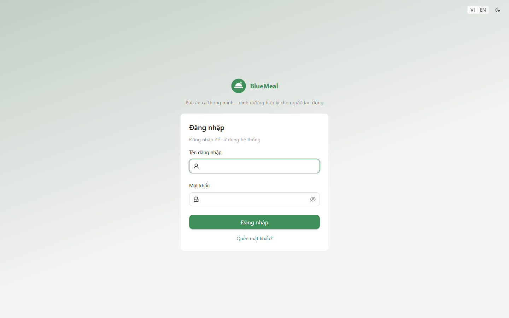
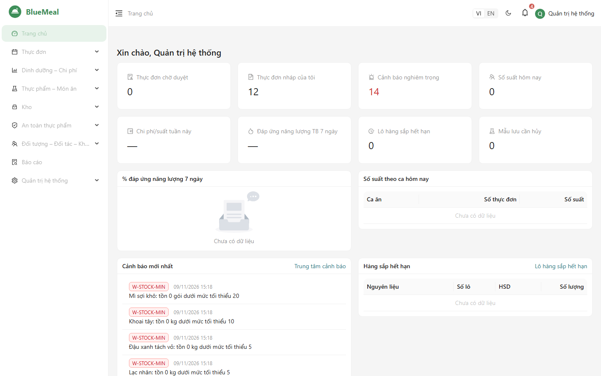
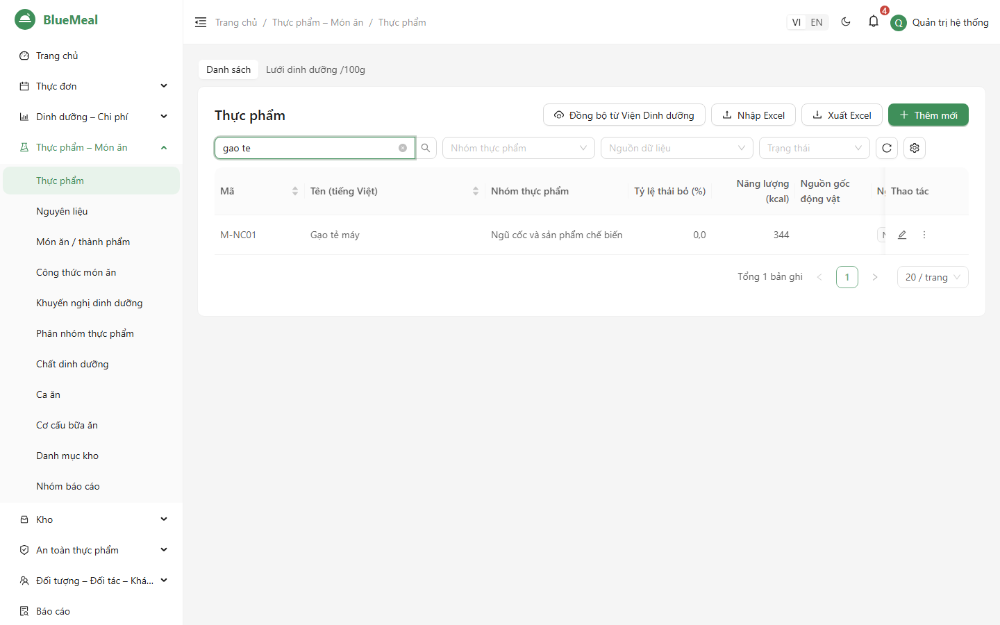
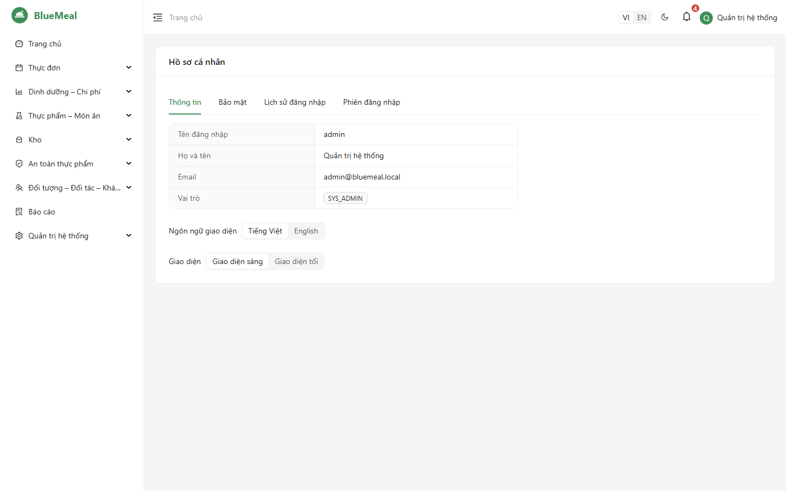

# HƯỚNG DẪN SỬ DỤNG — PHẦN CHUNG CHO MỌI NGƯỜI DÙNG

Áp dụng cho BlueMeal v1.0. Các tài liệu theo vai trò: [Quản trị](06_HDSD_QuanTri.md) · [Cán bộ dinh dưỡng](06_HDSD_DinhDuong.md) · [Bếp trưởng](06_HDSD_BepTruong.md) ·
[Thủ kho](06_HDSD_ThuKho.md) · [Kế toán](06_HDSD_KeToan.md) · [Người duyệt thực đơn / Lãnh đạo](06_HDSD_NguoiDuyet.md) · [Khách hàng đặt suất](06_HDSD_KhachHang.md).

## 1. Đăng nhập

1. Mở địa chỉ hệ thống do quản trị cung cấp (ví dụ `https://suatan.congty.vn`) bằng Chrome, Cốc Cốc, Edge hoặc Safari.
2. Chọn ngôn ngữ **VI / EN** ở góc màn hình (mặc định tiếng Việt).
3. Nhập **tên đăng nhập** và **mật khẩu** → *Đăng nhập*.
4. Nếu tài khoản bật xác thực hai lớp (MFA): mở ứng dụng Google/Microsoft Authenticator, nhập **mã 6 số**. Mất điện thoại thì dùng **mã khôi phục** hoặc chọn *Gửi mã qua email*.
5. Lần đầu đăng nhập hệ thống yêu cầu **đổi mật khẩu** (≥ 10 ký tự, có chữ hoa, chữ thường, số, ký tự đặc biệt, không trùng 5 mật khẩu gần nhất).

Lưu ý an toàn: sai mật khẩu 3 lần phải nhập mã kiểm tra (CAPTCHA); sai 5 lần tài khoản bị khóa 15 phút. Không thao tác 30 phút hệ thống tự đăng xuất.
Mật khẩu hết hạn sau 90 ngày — hệ thống sẽ yêu cầu đổi.

**Quên mật khẩu:** bấm *Quên mật khẩu?*, nhập email; mở email và bấm liên kết (dùng một lần, hiệu lực 15 phút) để đặt mật khẩu mới.

## 2. Bố cục màn hình

| Vùng | Chức năng |
|---|---|
| Thanh menu trái | Chỉ hiện các chức năng bạn được phân quyền; bấm biểu tượng ☰ để thu gọn |
| Đường dẫn (breadcrumb) | Cho biết bạn đang ở màn hình nào |
| Góc phải | Chọn ngôn ngữ VI/EN, chế độ sáng/tối, **chuông thông báo** (thực đơn chờ duyệt, kết quả duyệt, cảnh báo, báo cáo đã xuất xong), hồ sơ cá nhân, đăng xuất |
| Trang chủ | Các ô số liệu theo vai trò (thực đơn chờ duyệt, cảnh báo nghiêm trọng, số suất hôm nay, chi phí/suất, % đáp ứng năng lượng, hàng sắp hết hạn, mẫu lưu cần hủy) — bấm vào ô để mở màn hình chi tiết |

Trên điện thoại (≥ 360 px) menu thu vào nút ☰; các màn kho, kiểm thực, lưu mẫu, xem và duyệt thực đơn được thiết kế dùng trên điện thoại.

## 3. Thao tác chung trên danh mục

| Thao tác | Cách làm |
|---|---|
| Tìm kiếm | Gõ vào ô tìm kiếm, **không cần dấu** ("ca ro phi" → "Cá rô phi") |
| Lọc, sắp xếp | Dùng các ô lọc phía trên bảng; bấm tiêu đề cột để sắp xếp |
| Ẩn/hiện cột | Nút *Cột* — cấu hình được nhớ theo từng người dùng |
| Thêm / sửa | Nút *Thêm* hoặc biểu tượng bút; trường bắt buộc có dấu `*`; rời trang khi chưa lưu sẽ được hỏi lại |
| Xóa | Xóa mềm: bản ghi không còn hiện trong danh sách nhưng vẫn được lưu để truy vết lịch sử và báo cáo cũ; bản ghi đang được dùng không xóa được. Muốn tạm ngừng dùng một mục, nên **Khóa** thay vì xóa |
| Khóa / mở | Bản ghi bị khóa không dùng được ở nghiệp vụ mới |
| Lịch sử | Biểu tượng đồng hồ: ai sửa, lúc nào, giá trị trước/sau |
| Nhập Excel | *Nhập Excel* → *Tải file mẫu* → điền → chọn file → hệ thống **hiển thị lỗi từng dòng** → *Ghi dữ liệu* (chỉ ghi các dòng hợp lệ) |
| Xuất Excel | *Xuất Excel* — file có tên đơn vị, người lập, ngày lập |

Khi hai người cùng sửa một bản ghi, người lưu sau nhận thông báo "dữ liệu đã thay đổi" — tải lại trang và nhập lại.

## 4. Hồ sơ cá nhân

*Avatar → Hồ sơ cá nhân*: đổi mật khẩu; **bật MFA** (quét mã QR, nhập mã 6 số, lưu 10 mã khôi phục); đổi ngôn ngữ, giao diện sáng/tối; xem lịch sử đăng nhập và
các phiên đang mở (đăng xuất phiên lạ ngay nếu phát hiện).

## 5. Định dạng và quy ước

- Số và tiền: `1.234.567 ₫`; số thập phân dùng dấu phẩy (`12,5`).
- Ngày: `dd/MM/yyyy`; giờ theo múi giờ Việt Nam.
- Màu trạng thái luôn kèm chữ/biểu tượng: xanh = đạt, vàng = cảnh báo, đỏ = nghiêm trọng.
- In: các trang thực đơn công bố, phiếu kho, biểu mẫu kiểm thực, sổ lưu mẫu có nút *In* (khổ A4); có thể chọn "Lưu dưới dạng PDF" trong hộp thoại in của trình duyệt.

## 6. Hỗ trợ

Liên hệ bộ phận hỗ trợ theo `08_QuyTrinh_VanHanh_BaoHanh.md` (tiếp nhận và phản hồi trong 2 giờ). Khi báo lỗi, gửi kèm **mã lỗi** hiển thị trong thông báo (dạng `00-…`), thời điểm và ảnh chụp màn hình.
