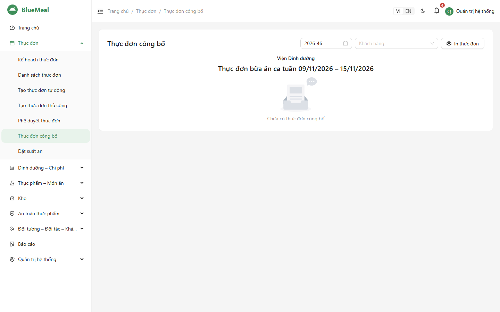
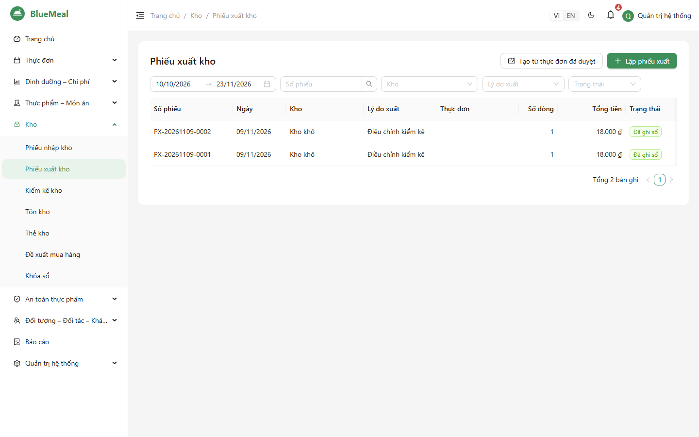
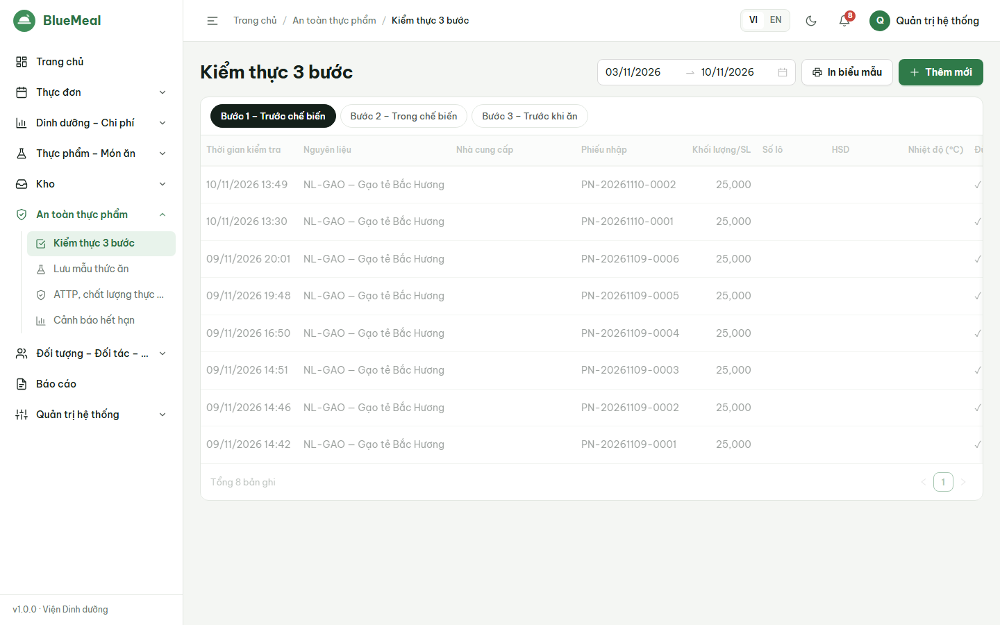
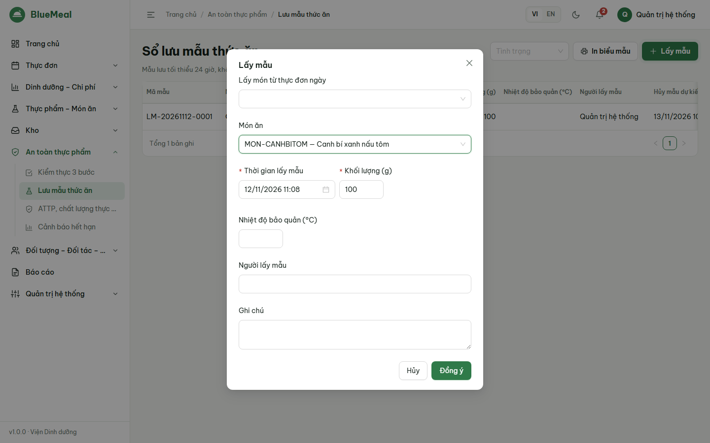

# HƯỚNG DẪN SỬ DỤNG — BẾP TRƯỞNG (HEAD_CHEF)

Đọc trước: [Phần chung](06_HDSD_00_ChungChoMoiNguoi.md). Lập thực đơn và công thức: xem [HDSD Cán bộ dinh dưỡng](06_HDSD_DinhDuong.md) mục 2–3 (bếp trưởng có cùng thao tác).

## 1. Công việc trong ngày

| Thời điểm | Việc | Màn hình |
|---|---|---|
| Đầu ca | Xem thực đơn đã duyệt của ngày, số suất theo ca | *Trang chủ*, *Thực đơn → Thực đơn công bố* |
| Trước chế biến | Đề nghị xuất kho theo thực đơn (thủ kho ghi sổ); **kiểm thực bước 1** khi nhận hàng | *Kho → Phiếu xuất kho → Tạo từ thực đơn đã duyệt*; *An toàn thực phẩm → Kiểm thực 3 bước* |
| Trong chế biến | **Kiểm thực bước 2** | *Kiểm thực 3 bước* |
| Trước khi ăn | **Kiểm thực bước 3**; **lấy mẫu lưu** từng món | *Kiểm thực 3 bước*; *Sổ lưu mẫu* |
| Hôm sau (≥ 24 giờ) | **Hủy mẫu** đến hạn | *Sổ lưu mẫu* (hệ thống nhắc qua cảnh báo) |

## 2. Xem thực đơn và định lượng

- *Thực đơn công bố*: chọn tuần (và khách hàng) → bảng ngày × ca với món và năng lượng; *In* khổ A4 để dán tại bếp/nhà ăn.
- Định lượng nấu: mở công thức của món, nhập **số suất** của ca (ví dụ 350) để xem khối lượng sống/sạch từng nguyên liệu và số đơn vị mua.

## 3. Đề nghị xuất kho theo thực đơn

*Kho → Phiếu xuất kho → Tạo từ thực đơn đã duyệt* → chọn thực đơn → hệ thống tự tính **định lượng × số suất** cho từng nguyên liệu, gợi ý **lô hết hạn trước xuất trước (FEFO)**,
tạo **phiếu xuất dự kiến** cho từng kho. Thủ kho kiểm tra và *Ghi sổ*. Chỉ thực đơn đã duyệt/công bố mới tạo được phiếu xuất.

## 4. Kiểm thực 3 bước

1. *An toàn thực phẩm → Kiểm thực 3 bước*, chọn tab bước:
   - **Bước 1 – Trước chế biến**: thực phẩm nhập vào — nguyên liệu, nhà cung cấp, số lượng, lô, hạn dùng, nhiệt độ, giấy tờ nguồn gốc, cảm quan. (Khi thủ kho ghi sổ phiếu nhập có kiểm tra chất lượng, biên bản bước 1 được **tự tạo**.)
   - **Bước 2 – Trong chế biến**: chọn món của thực đơn trong ngày (*Lấy món từ thực đơn ngày*), giờ bắt đầu/kết thúc, người chế biến, điều kiện vệ sinh, cảm quan.
   - **Bước 3 – Trước khi ăn**: giờ chia món, nhiệt độ, dụng cụ chia/chứa, cảm quan.
2. Tích các **tiêu chí kiểm tra** (danh sách do quản trị cấu hình), chọn **Kết quả**: Đạt / Đạt có điều kiện / Không đạt. **Không đạt bắt buộc ghi biện pháp xử lý.**
3. *In biểu mẫu*: in theo mẫu số 1/2/3 cho khoảng ngày đang lọc.

Trên điện thoại: mở trình duyệt, đăng nhập, thao tác như trên (form tự xếp một cột).

## 5. Lưu mẫu thức ăn

1. *Sổ lưu mẫu → Lấy mẫu*: chọn món (từ thực đơn hôm nay hoặc tìm món), thời gian lấy, **khối lượng** (tối thiểu theo cấu hình, mặc định 100 g), nhiệt độ bảo quản, người lấy mẫu.
2. Hệ thống tự đặt **thời gian hủy dự kiến** = thời gian lấy + thời gian lưu tối thiểu (mặc định 24 giờ). Không thể hủy sớm hơn.
3. Khi đến hạn, trạng thái chuyển *Đến hạn hủy* và có cảnh báo → *Hủy mẫu* (ghi chú nếu cần).
4. *In* sổ lưu mẫu theo khoảng thời gian.
