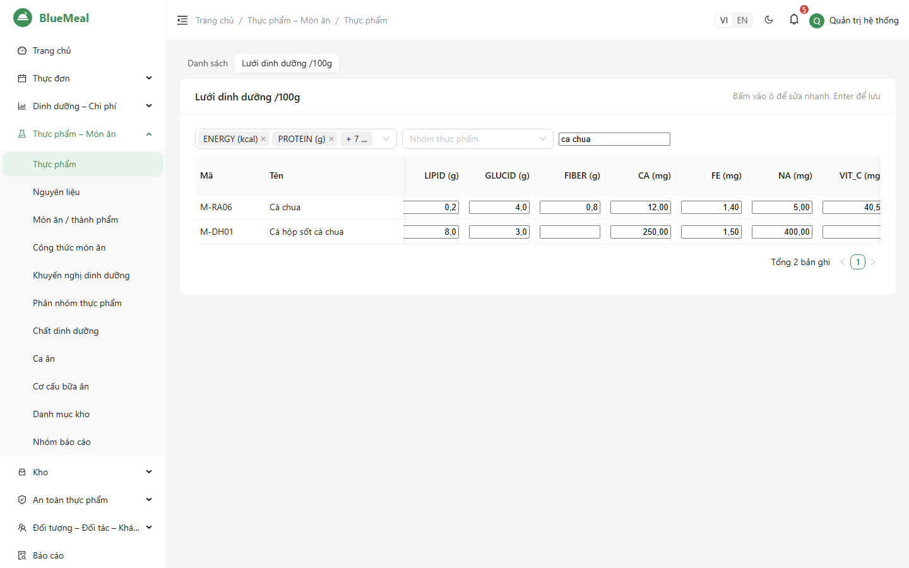
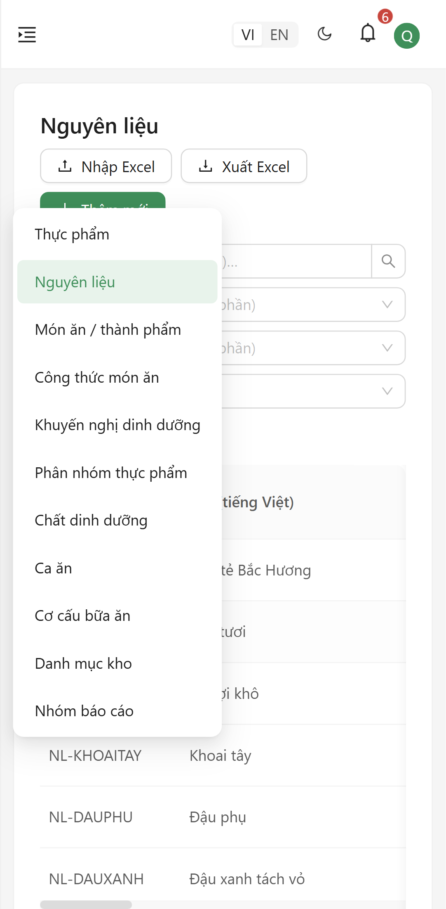
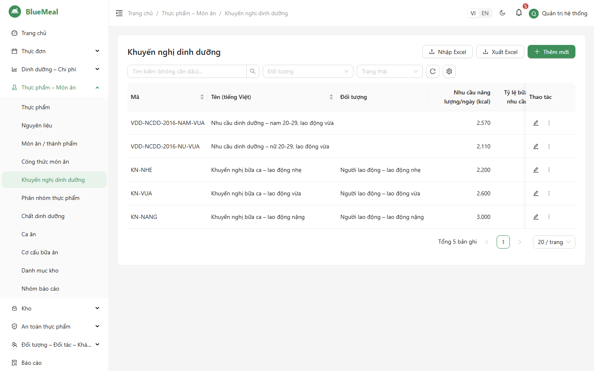
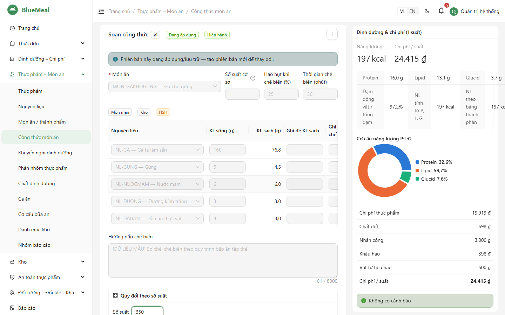
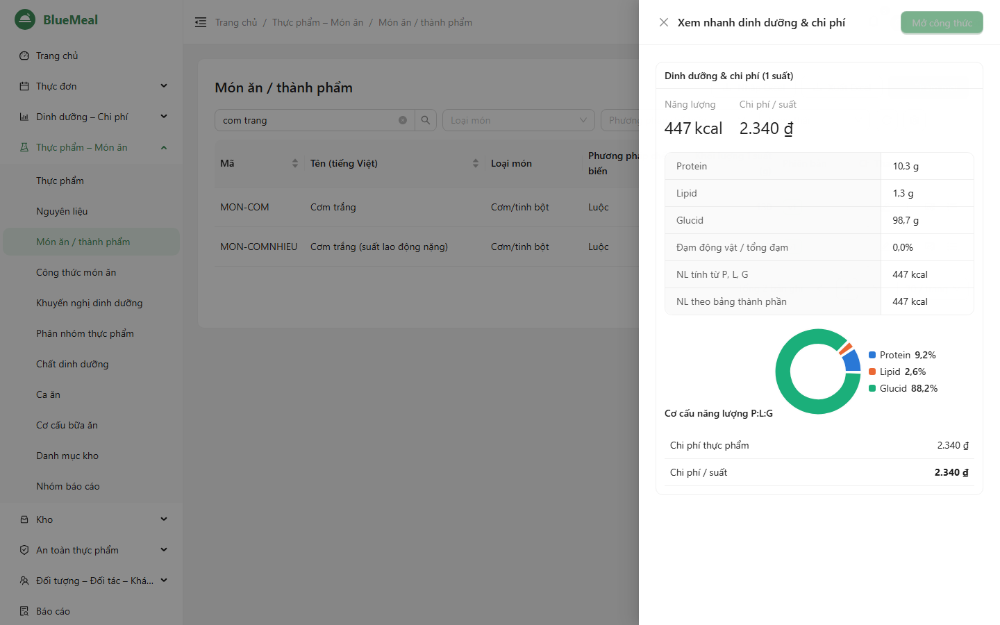
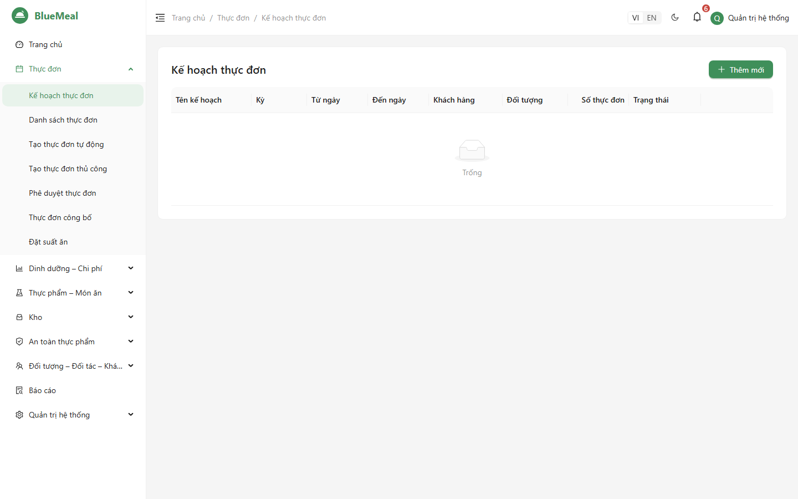
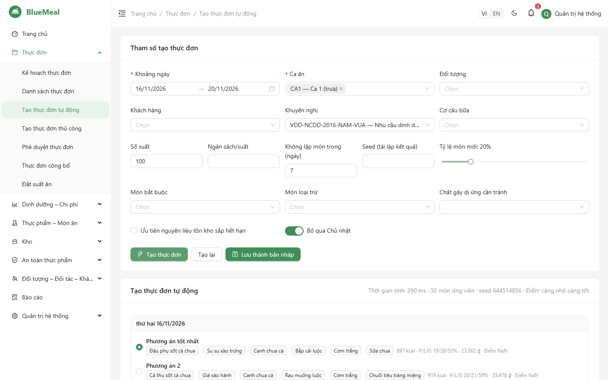
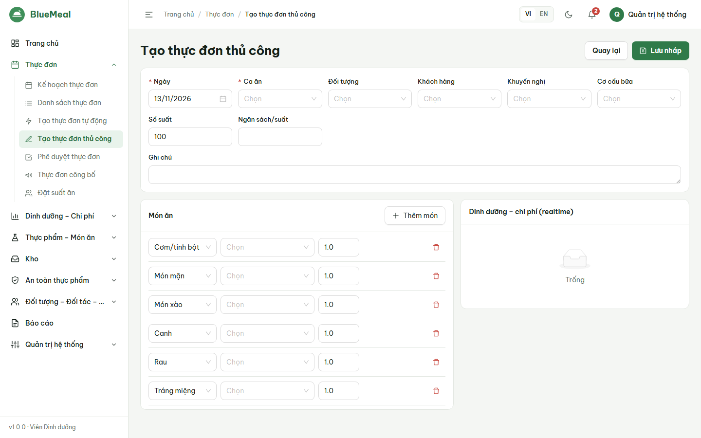
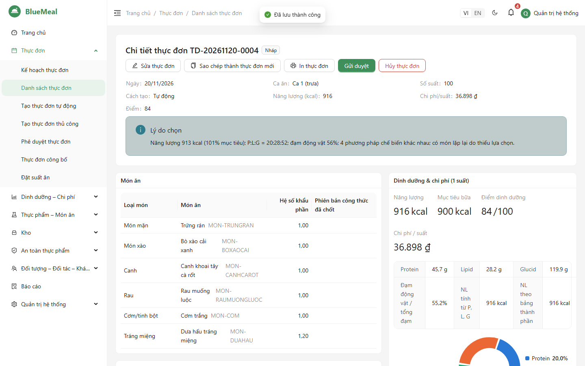
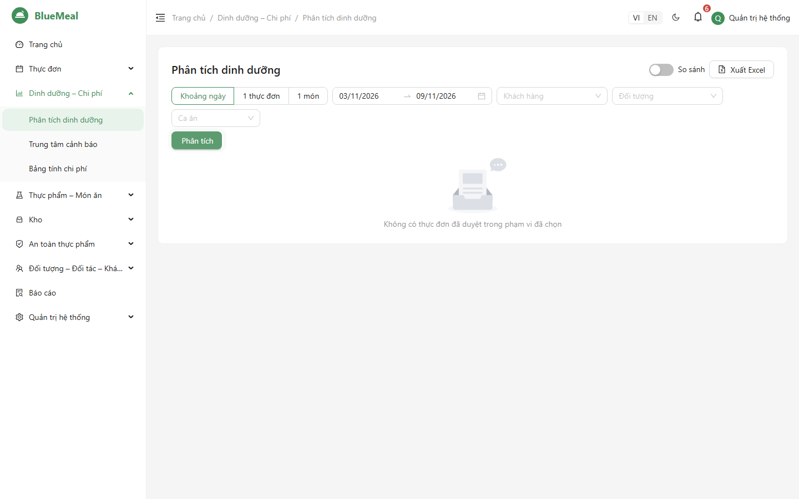

# HƯỚNG DẪN SỬ DỤNG — CÁN BỘ DINH DƯỠNG (NUTRITIONIST)

Đọc trước: [Phần chung](06_HDSD_00_ChungChoMoiNguoi.md).

## 1. Dữ liệu nền dinh dưỡng

### 1.1 Thực phẩm (bảng thành phần)

- *Thực phẩm – Món ăn → Thực phẩm*: mỗi thực phẩm có nhóm, **tỷ lệ thải bỏ**, bảng **giá trị dinh dưỡng/100 g phần ăn được** (sửa nhanh trực tiếp trên lưới).
- Cột *Nguồn* cho biết nhập tay / import / **Viện Dinh dưỡng** (kèm phiên bản). Dữ liệu từ Viện Dinh dưỡng **khóa sửa** mặc định; cần quyền mở khóa.
- *Đồng bộ từ Viện Dinh dưỡng*: lấy dữ liệu mới nhất (thông báo số bản ghi nhận/tạo/cập nhật/xung đột). Xung đột do quản trị xử lý.

### 1.2 Nguyên liệu

Nguyên liệu là thứ mua và nhập kho; mỗi nguyên liệu **ánh xạ một thực phẩm** (để tính dinh dưỡng), có đơn vị mua và **số gram/đơn vị**, giá tham chiếu, tồn tối thiểu, chất gây dị ứng, mã vạch.

### 1.3 Đối tượng và khuyến nghị

1. *Đối tượng*: nhóm người ăn (ví dụ "Nam lao động vừa 18–30").
2. *Khuyến nghị*: năng lượng/ngày, **tỷ lệ năng lượng bữa** (ví dụ 35 % cho bữa trưa), khoảng P:L:G, tỷ lệ đạm động vật, ngưỡng từng chất (min/max **mỗi bữa**, mức cảnh báo/nghiêm trọng); gắn vào đối tượng.
3. *Cơ cấu bữa*: số món theo loại (cơm, món mặn, xào, canh, rau, tráng miệng) — dùng khi tạo thực đơn tự động.

## 2. Món ăn và công thức

1. *Món ăn → Thêm*: tên, loại món, phương pháp chế biến (luộc, hấp, xào, chiên…), ảnh. Biểu tượng 👁 *Xem nhanh* hiển thị dinh dưỡng và chi phí 1 suất.
2. *Công thức → Thêm* (hoặc mở công thức của món): chọn số suất chuẩn, thêm nguyên liệu và **khối lượng sống (g)** — hệ thống tự tính khối lượng sạch theo tỷ lệ thải bỏ;
   bảng bên phải cập nhật **ngay khi gõ**: năng lượng, P/L/G, biểu đồ P:L:G, chi phí/suất, cảnh báo.
3. Ô *Số suất* để xem định lượng cho số suất bất kỳ (ví dụ 350 suất) — hữu ích khi in cho bếp.
4. **Phiên bản**: muốn thay đổi công thức đang dùng → *Tạo phiên bản mới* → sửa → *Kích hoạt* (bản cũ được lưu trữ). *So sánh* 2 phiên bản để thấy chênh lệch dinh dưỡng – chi phí.
   *Nhân bản* để tạo công thức cho món tương tự.
5. **Nhập nhiều công thức từ Excel**: *Công thức → Nhập Excel* → *Tải file mẫu* → mỗi dòng một nguyên liệu (mã món, mã nguyên liệu, khối lượng sống cho số suất chuẩn) → chọn file → xem lỗi → *Nhập*. Món đã có công thức đang dùng sẽ có thêm **phiên bản nháp** để bạn kiểm tra rồi kích hoạt.

## 3. Lập thực đơn

### 3.1 Kế hoạch tuần/tháng

*Thực đơn → Kế hoạch thực đơn → Thêm*: tên, kỳ, khoảng ngày, khách hàng, đối tượng, khuyến nghị, cơ cấu, ca ăn, ngân sách/suất, số suất dự kiến.
Mở kế hoạch để xem **lịch ngày × ca** (màu theo trạng thái). Trên lịch có thể:
- *Tạo tự động cho kế hoạch* (sinh nháp cho cả kỳ);
- **kéo-thả món** giữa các ngày (chỉ thực đơn Nháp/Trả lại);
- *Nhân bản tuần* sang tuần khác; *Áp dụng cho khách hàng khác*;
- bấm *+* ở ô trống để thêm thực đơn thủ công cho ngày/ca đó.

### 3.2 Tạo thực đơn tự động

1. *Thực đơn → Tạo thực đơn tự động*: chọn khoảng ngày, ca ăn, đối tượng (hoặc khuyến nghị), cơ cấu bữa, số suất, ngân sách/suất, không lặp món trong N ngày, món bắt buộc / loại trừ,
   chất gây dị ứng cần tránh, ưu tiên nguyên liệu sắp hết hạn, tỷ lệ món mới, seed.
2. *Tạo thực đơn*: mỗi ngày hiện **phương án tốt nhất + 2 phương án thay thế** với năng lượng, P/L/G, chi phí, điểm (càng nhỏ càng tốt) và **lý do chọn**.
3. Chọn phương án cho từng ngày → *Lưu thành bản nháp*. *Tạo lại* để có tổ hợp khác (seed mới); cùng seed luôn cho cùng kết quả.

### 3.3 Tạo / sửa thủ công

Chọn ngày, ca, đối tượng/khách hàng; mỗi dòng là một **loại món** → chọn món (lọc đúng loại), chỉnh **hệ số khẩu phần**. Panel bên phải tính **realtime**: năng lượng so với khuyến nghị,
P:L:G, % đáp ứng từng chất, chi phí/suất so với ngân sách, **danh sách cảnh báo** (vàng = cảnh báo, đỏ = nghiêm trọng). Với thực đơn đã lưu, nút ⇄ *Đổi món* gợi ý 5 món cùng loại làm điểm tốt hơn.

### 3.4 Gửi duyệt

Mở thực đơn → kiểm tra snapshot → *Gửi duyệt*. Nếu còn **cảnh báo nghiêm trọng** phải nhập lý do (người duyệt cần quyền chấp nhận). Kết quả duyệt được báo qua chuông thông báo.
Thực đơn **Trả lại / Từ chối** có ý kiến của người duyệt — sửa rồi gửi lại.

## 4. Phân tích và cảnh báo

- *Dinh dưỡng – Chi phí → Phân tích dinh dưỡng*: chọn **khoảng ngày** (lọc khách hàng/đối tượng/ca), **1 thực đơn** hoặc **1 món** → *Phân tích*: thẻ năng lượng/khuyến nghị/% đáp ứng,
  biểu đồ P:L:G, thanh % đáp ứng từng chất (kèm biểu tượng đạt/chưa đạt), biểu đồ vi chất, **xu hướng năng lượng theo ngày**, trung bình tuần/tháng, thống kê cảnh báo. Bật *So sánh* để đặt 2 phương án cạnh nhau. *Xuất Excel*.
- *Trung tâm cảnh báo*: xem các cảnh báo vận hành (hết hạn, tồn tối thiểu, lưu mẫu) và đánh dấu đã xử lý.
- Báo cáo liên quan: RPT-06 (mức đáp ứng khuyến nghị), RPT-07 (phân tích từng thực đơn), RPT-08 (thống kê cảnh báo), RPT-09 (tần suất món/nguyên liệu).

## 5. Lưu ý chuyên môn

- Năng lượng tính theo bảng thành phần nếu có, nếu không theo P×4 + L×9 + G×4; chất dinh dưỡng nhân **hệ số giữ lại** theo phương pháp chế biến.
- Làm tròn hiển thị: năng lượng 0, đa lượng 1, vi lượng 2 chữ số thập phân (tính toán bên trong không làm tròn).
- Nguyên liệu chưa ánh xạ thực phẩm hoặc thực phẩm thiếu dữ liệu sinh cảnh báo **Thiếu dữ liệu** — cần bổ sung để kết quả chính xác.
