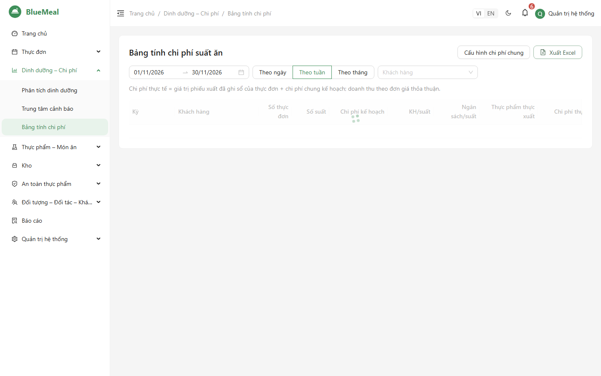
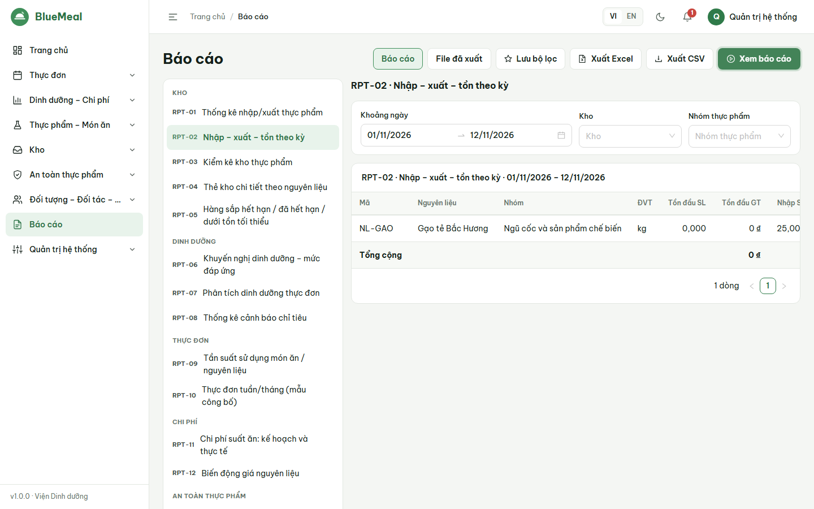
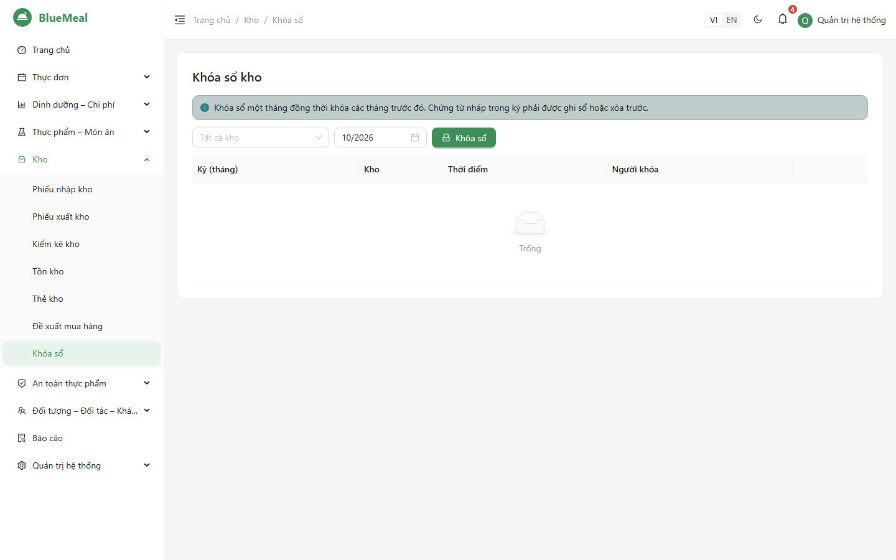

# HƯỚNG DẪN SỬ DỤNG — KẾ TOÁN (ACCOUNTANT)

Đọc trước: [Phần chung](06_HDSD_00_ChungChoMoiNguoi.md). Vai trò Kế toán bắt buộc bật MFA.

## 1. Giá nguyên liệu

- *Nguyên liệu*: **giá tham chiếu** theo đơn vị mua; mỗi lần đổi giá được lưu **lịch sử giá**. Giá từ phiếu nhập đã ghi sổ cũng được ghi lịch sử.
- *Đối tác → Hợp đồng*: bảng giá theo nguyên liệu, thời hạn hiệu lực — dùng khi cấu hình tính giá theo hợp đồng.
- Cách lấy đơn giá khi tính chi phí (quản trị cấu hình): giá tham chiếu / lần nhập gần nhất / **bình quân gia quyền tồn kho (mặc định)** / giá hợp đồng.
- **Chi phí chung** (gas, điện nước, nhân công…): theo % chi phí thực phẩm hoặc cố định/suất (*Cấu hình hệ thống → Chi phí*).

## 2. Bảng tính chi phí suất ăn

*Dinh dưỡng – Chi phí → Bảng tính chi phí*: chọn khoảng ngày, tổng hợp **theo ngày/tuần/tháng**, khách hàng.

| Cột | Ý nghĩa |
|---|---|
| Chi phí kế hoạch | Σ chi phí/suất của thực đơn đã duyệt × số suất (gồm chi phí chung) |
| Thực phẩm thực xuất | Giá trị các **phiếu xuất đã ghi sổ** gắn với thực đơn |
| Chi phí thực tế | Thực phẩm thực xuất + chi phí chung kế hoạch |
| Doanh thu | Số suất × **đơn giá thỏa thuận** với khách hàng (theo ca/đối tượng, thời hạn) |
| Chênh lệch | Thực tế − kế hoạch (đỏ = vượt) |
| Lãi gộp | Doanh thu − chi phí thực tế |

Biểu đồ cột so sánh kế hoạch – thực tế theo kỳ. Nút *Xuất Excel* mở báo cáo RPT-11.

## 3. Báo cáo cho kế toán

| Mã | Báo cáo | Gợi ý dùng |
|---|---|---|
| RPT-01 | Thống kê nhập/xuất thực phẩm (theo nguyên liệu / nhóm / nhà cung cấp) | Đối chiếu công nợ nhà cung cấp |
| RPT-02 | Nhập – xuất – tồn | Khóa sổ cuối tháng |
| RPT-04 | Thẻ kho chi tiết | Tra cứu biến động một nguyên liệu |
| RPT-11 | Chi phí suất ăn kế hoạch và thực tế theo khách hàng | Quyết toán với khách hàng |
| RPT-12 | Biến động giá nguyên liệu | Theo dõi giá đầu vào |

Thao tác: *Báo cáo* → chọn báo cáo ở danh sách trái → đặt bộ lọc → *Xem báo cáo* (2.000 dòng đầu, có dòng tổng) → *Xuất Excel* (có tiêu đề đơn vị, kỳ báo cáo, người lập, ngày lập, chữ ký).
Báo cáo trên 3.000 dòng được **xuất nền**: xem ở tab *File đã xuất*, có thông báo khi xong (file lưu 7 ngày). *Lưu bộ lọc* để dùng lại hằng tháng.

## 4. Khóa sổ cuối tháng

1. Đề nghị thủ kho ghi sổ/xóa hết chứng từ nháp và kiểm kê cuối tháng.
2. Đối chiếu RPT-02 Nhập – xuất – tồn của tháng.
3. *Kho → Khóa sổ*: chọn kho (hoặc *Tất cả kho*) và tháng → *Khóa sổ*. Khóa một tháng đồng thời khóa các tháng trước; còn chứng từ nháp thì hệ thống báo số lượng và không cho khóa.
4. *Mở khóa* chỉ khi thật cần điều chỉnh (thao tác được ghi nhật ký).

