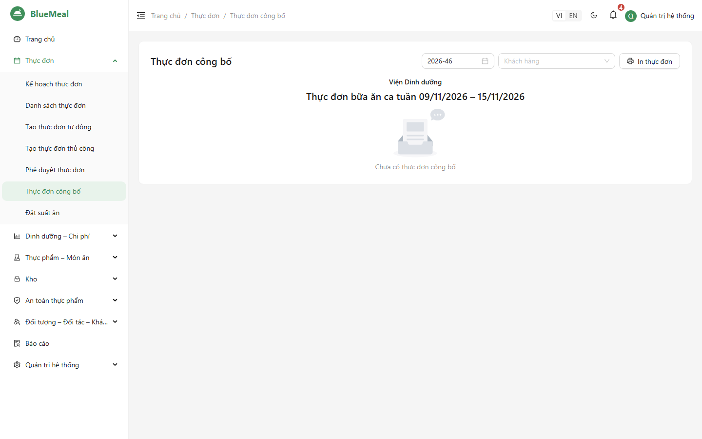
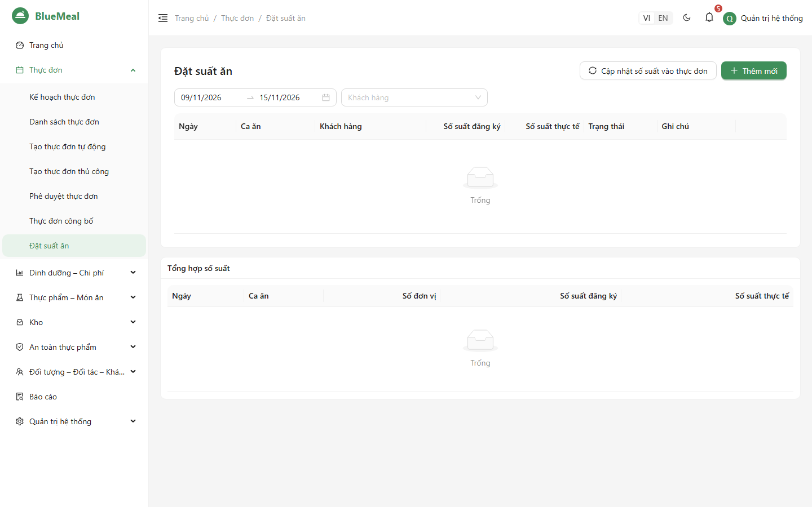

# HƯỚNG DẪN SỬ DỤNG — ĐẠI DIỆN ĐƠN VỊ ĐẶT SUẤT ĂN (CUSTOMER_REP)

Đọc trước: [Phần chung](06_HDSD_00_ChungChoMoiNguoi.md). Tài khoản của bạn chỉ thấy **dữ liệu của đơn vị mình**.

## 1. Xem thực đơn đã công bố

1. *Thực đơn → Thực đơn công bố*: chọn **tuần** → bảng ngày × ca hiển thị các món và năng lượng (kcal) của từng bữa.
2. *In* để dán bảng tin (khổ A4) hoặc chọn "Lưu dưới dạng PDF" trong hộp thoại in để gửi cho người lao động.
3. Dùng tốt trên điện thoại.

## 2. Đặt và điều chỉnh số suất

1. *Thực đơn → Đặt suất ăn → Thêm*: chọn ngày, ca, đối tượng (nếu có), nhập **số suất đăng ký** → *Lưu* (trạng thái *Đã xác nhận*).
2. Điều chỉnh: bấm biểu tượng bút trên dòng, sửa số suất → trạng thái chuyển *Đã điều chỉnh*. Sau khi bếp chốt (*Đã đóng*) chỉ bộ phận suất ăn sửa được.
3. Có thể nhập **số suất thực tế** sau bữa ăn để đối chiếu.
4. Bảng **Tổng hợp số suất** bên dưới cho biết tổng theo ngày × ca.

Số suất đăng ký được bộ phận suất ăn cập nhật vào thực đơn để tính định lượng và đi chợ — nên đặt trước theo thời hạn hai bên thỏa thuận.

## 3. Thông tin đơn vị và đơn giá

Đơn giá suất ăn và thông tin hợp đồng do bộ phận suất ăn quản lý; đại diện đơn vị liên hệ bộ phận này khi cần đối chiếu (quyền mặc định của vai trò không gồm danh mục khách hàng).
