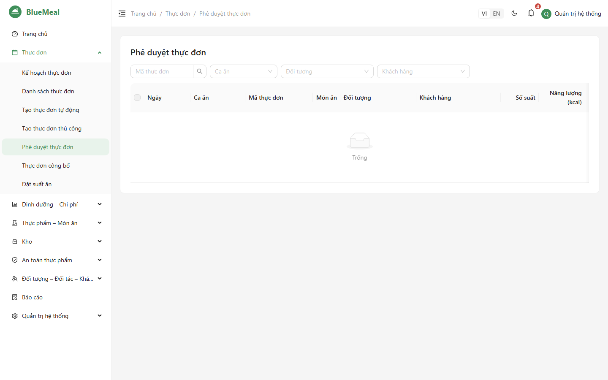
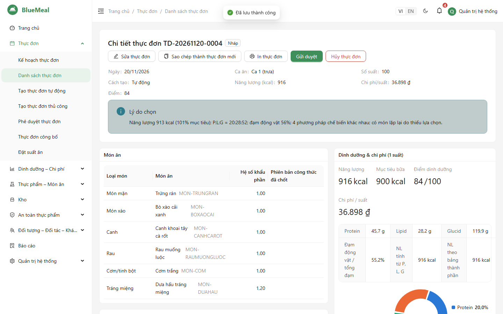
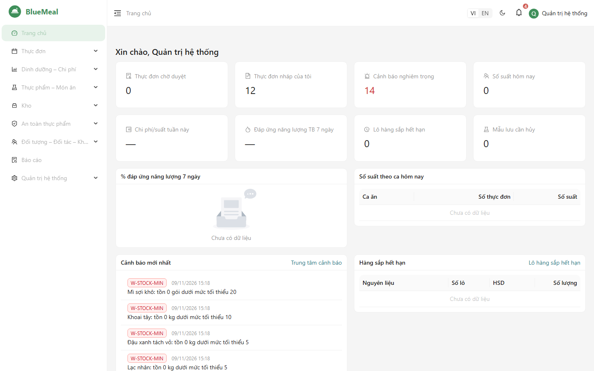

# HƯỚNG DẪN SỬ DỤNG — NGƯỜI DUYỆT THỰC ĐƠN (MENU_APPROVER) VÀ LÃNH ĐẠO (MANAGER)

Đọc trước: [Phần chung](06_HDSD_00_ChungChoMoiNguoi.md). Hai vai trò này bắt buộc bật MFA.

## 1. Quy trình duyệt

```
Nháp → Chờ duyệt → Đã duyệt → Công bố
            ↘ Trả lại (sửa rồi gửi lại)   ↘ Từ chối
Đã duyệt / Công bố → Thu hồi (về Nháp, cần lý do)      Bất kỳ (trừ Công bố) → Hủy
```

- **1 cấp**: người duyệt duyệt là xong. **2 cấp** (quản trị cấu hình): người duyệt duyệt cấp 1, **lãnh đạo** duyệt cấp cuối.
- Thực đơn đã duyệt **bị khóa**, phiên bản công thức được chốt; chỉ thực đơn đã duyệt/công bố mới dùng để nấu, xuất kho, đề xuất mua.

## 2. Duyệt thực đơn



1. Chuông thông báo báo "Thực đơn … chờ duyệt", hoặc vào *Thực đơn → Phê duyệt thực đơn* (danh sách **chờ tôi duyệt**).
2. Bấm dòng để mở chi tiết: món, số suất, năng lượng, chi phí/suất, **snapshot dinh dưỡng** (P:L:G, % đáp ứng từng chất), **cảnh báo**, lịch sử duyệt, lý do chọn (thực đơn tự động).



3. Chọn:
   - **Duyệt** (có thể ghi ý kiến);
   - **Trả lại** để người lập sửa — **bắt buộc ghi ý kiến**;
   - **Từ chối** — **bắt buộc ghi ý kiến**.
4. Thực đơn có **cảnh báo nghiêm trọng**: người lập đã ghi lý do khi gửi; chỉ người có quyền *chấp nhận cảnh báo nghiêm trọng* mới duyệt được (hệ thống ghi nhận việc chấp nhận).
5. **Duyệt hàng loạt**: tích chọn nhiều dòng (ví dụ cả tuần) → *Duyệt các mục đã chọn* — kết quả từng thực đơn được báo lại (dòng nào lỗi kèm lý do).

## 3. Công bố, thu hồi, hủy

- *Công bố*: thực đơn hiện ở trang **Thực đơn công bố** cho bếp, người lao động và khách hàng (không hiện chi phí). Có thể công bố hàng loạt từ *Danh sách thực đơn*.
- *Thu hồi*: khi cần sửa thực đơn đã duyệt — nhập lý do; thực đơn về Nháp, công thức được mở chốt, hành động được ghi nhật ký.
- *Hủy*: nhập lý do.

## 4. Theo dõi cho lãnh đạo



- **Trang chủ**: thực đơn chờ duyệt, cảnh báo nghiêm trọng, số suất hôm nay theo ca, **chi phí/suất tuần này so với ngân sách**, **% đáp ứng năng lượng trung bình 7 ngày**, hàng sắp hết hạn, mẫu lưu cần hủy.
- *Phân tích dinh dưỡng* (khoảng ngày, so sánh 2 đối tượng), *Bảng tính chi phí*, *Trung tâm cảnh báo*.
- Báo cáo: RPT-06 mức đáp ứng khuyến nghị (số ngày đạt/không đạt), RPT-08 thống kê cảnh báo, RPT-10 thực đơn tuần/tháng, RPT-11 chi phí kế hoạch – thực tế, RPT-13/14 sổ kiểm thực và lưu mẫu.
