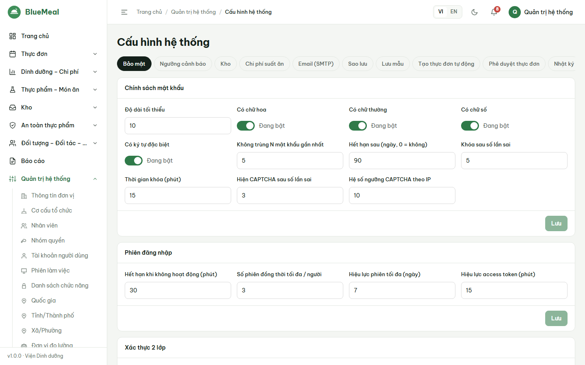
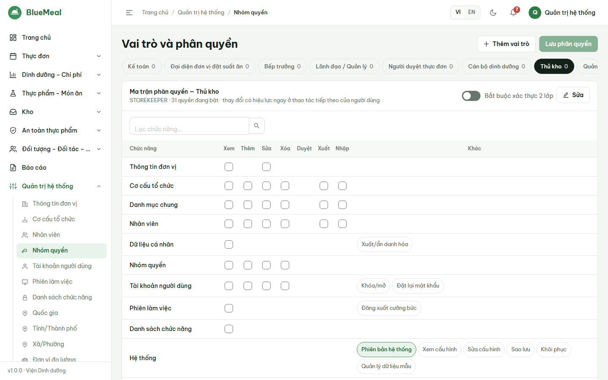
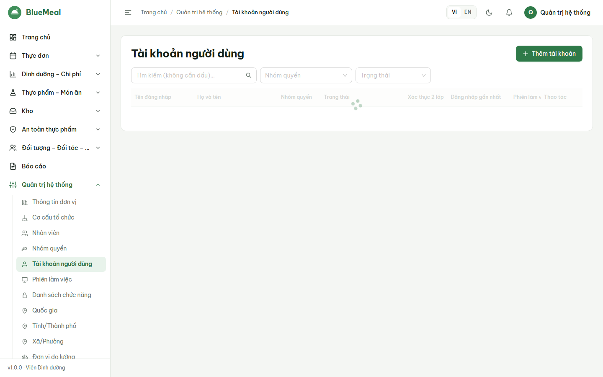
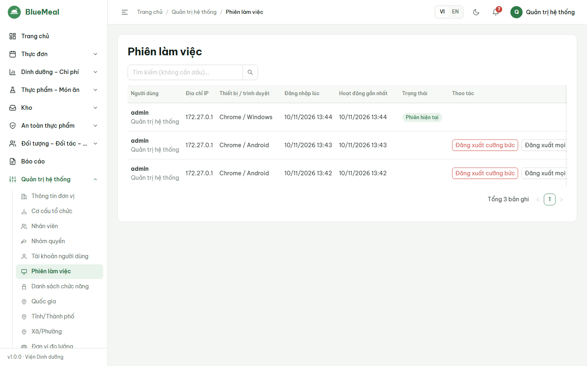
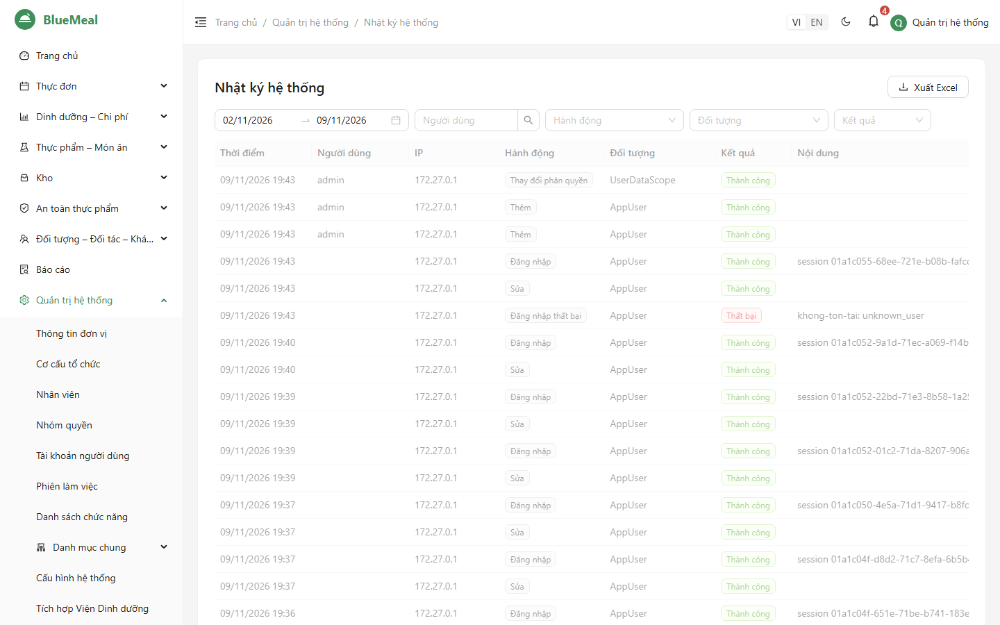
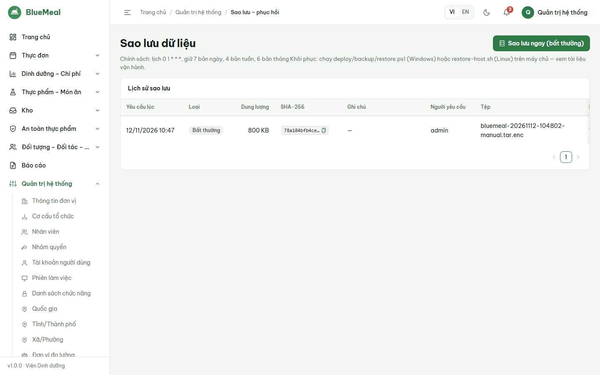
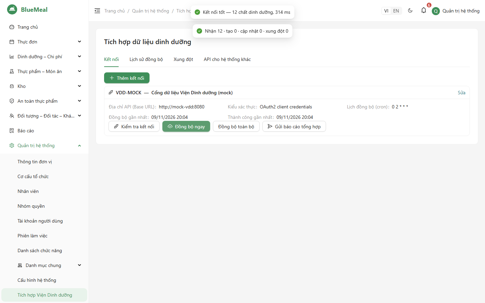
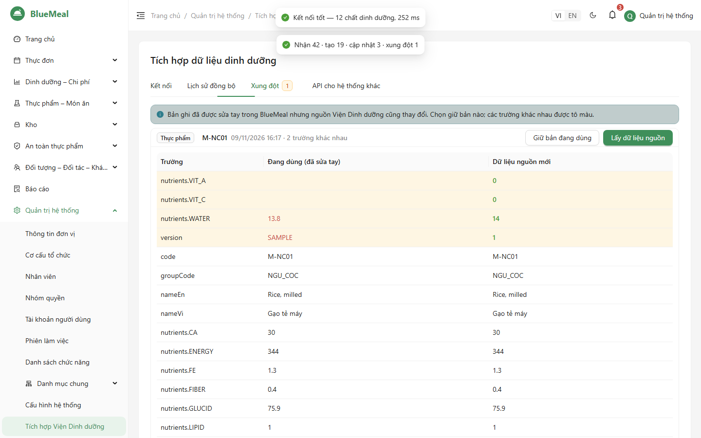

# HƯỚNG DẪN SỬ DỤNG — QUẢN TRỊ HỆ THỐNG (SYS_ADMIN)

Đọc trước: [Phần chung](06_HDSD_00_ChungChoMoiNguoi.md). Mặc định mọi tài khoản bắt buộc bật MFA (cấu hình tại *Cấu hình hệ thống*); vai trò Quản trị luôn bắt buộc.

## 1. Thiết lập ban đầu (một lần)

| Bước | Màn hình | Việc cần làm |
|---|---|---|
| 1 | *Quản trị → Thông tin đơn vị* | Tên, tên tiếng Anh, mã số thuế, địa chỉ, người đại diện, **logo** (PNG/JPEG/WEBP ≤ 2 MB — hiện trên header và báo cáo) |
| 2 | *Quản trị → Cơ cấu tổ chức* | Tạo cây phòng ban; kéo-thả để sắp xếp |
| 3 | *Quản trị → Cấu hình hệ thống* | Email (SMTP) → *Gửi thử*; chính sách mật khẩu/phiên/MFA; số cấp duyệt thực đơn (1 hoặc 2); phương pháp giá kho; chi phí chung; thời gian lưu mẫu; lịch sao lưu |
| 4 | *Danh mục chung* | Kiểm tra đơn vị đo, tỉnh/thành (đã có sẵn) |
| 5 | *Quản trị → Nhân viên* | Nhập hoặc import Excel danh sách nhân viên |
| 6 | *Quản trị → Nhóm quyền* | Kiểm tra 8 nhóm quyền mặc định, tạo thêm nếu cần |
| 7 | *Quản trị → Tài khoản người dùng* | Tạo tài khoản, gán nhóm quyền, **phạm vi dữ liệu** (kho cho thủ kho, khách hàng cho đại diện khách hàng) |
| 8 | *Quản trị → Dữ liệu mẫu* | Xóa dữ liệu mẫu trước khi vận hành chính thức (nếu đã nạp để đào tạo) |

## 2. Nhân viên và dữ liệu cá nhân

- SĐT, email, CCCD được **mã hóa** khi lưu; người không có quyền `pii.view` chỉ thấy dạng che (`09******89`).
- Tạo tài khoản đăng nhập từ nhân viên: nút *Tạo tài khoản* trên dòng nhân viên.
- Theo yêu cầu của người lao động (Luật Bảo vệ dữ liệu cá nhân 91/2025/QH15): *Xuất dữ liệu cá nhân* (file JSON) và *Ẩn danh hóa* (không đảo ngược, tài khoản liên kết bị khóa). Mọi lần xem/xuất đều ghi nhật ký.
- **Thông báo xử lý dữ liệu cá nhân**: *Cấu hình hệ thống → Bảo mật → Thông báo xử lý dữ liệu cá nhân*. Soạn nội dung tiếng Việt và tiếng Anh (bản mặc định là bản mẫu, cần bộ phận pháp chế rà soát). Sau khi đăng nhập, người dùng phải bấm *Tôi đã đọc và đồng ý* mới dùng được hệ thống; bấm *Không đồng ý* sẽ đăng xuất. Khi sửa nội dung và lưu, phiên bản tăng 1 và mọi người phải đồng ý lại; lưu lại đúng nội dung cũ thì không tăng. Bỏ chọn *Bật* nếu Viện xác định không cần sự đồng ý. Thời điểm và phiên bản người dùng đã đồng ý hiện ở tab thông tin của tài khoản và trong *Hồ sơ cá nhân* của người đó; mỗi lần đồng ý ghi nhật ký `Consent`.

## 3. Nhóm quyền và tài khoản

1. *Nhóm quyền → Thêm*: nhập mã, tên VI/EN; tích chọn ma trận **module × hành động** (Xem / Thêm / Sửa / Xóa / Duyệt / Xuất / Nhập). Có thể đánh dấu nhóm *bắt buộc MFA*.
2. *Tài khoản người dùng → Thêm*: tên đăng nhập, họ tên, email, nhóm quyền, phạm vi dữ liệu. Mật khẩu tạm được tạo; người dùng **bắt buộc đổi ở lần đầu**.
3. Thao tác trên tài khoản: *Khóa/Mở* (khóa sẽ đăng xuất ngay mọi phiên), *Đặt lại mật khẩu*, *Đặt lại MFA* (khi người dùng mất thiết bị), *Phiên đăng nhập*.
4. **Tự khóa tài khoản không dùng**: tài khoản không đăng nhập quá số ngày ở *Cấu hình hệ thống → Chính sách mật khẩu → Khóa tài khoản không đăng nhập sau (ngày)* (mặc định 45, đặt 0 để tắt) bị khóa tự động lúc 00:15 hằng ngày, mọi phiên bị đăng xuất. Nhật ký ghi hành động *Khóa* với nội dung `inactive_45d`. Tài khoản chưa đăng nhập lần nào tính từ ngày tạo. Khi người dùng còn cần, bấm *Mở*: thời hạn 45 ngày tính lại từ lúc mở. Hệ thống không tự khóa quản trị hệ thống cuối cùng còn hoạt động.

Thay đổi quyền có hiệu lực ngay ở thao tác tiếp theo của người dùng và được ghi nhật ký `PermissionChange`. Không thể xóa quản trị cuối cùng.

## 4. Phiên làm việc

*Quản trị → Phiên làm việc*: ai đang đăng nhập, IP, thiết bị, thời gian đăng nhập/hoạt động gần nhất. *Đăng xuất* một phiên hoặc *Đăng xuất tất cả* của một người.

## 5. Nhật ký hệ thống

Lọc theo người dùng, hành động (đăng nhập, sửa, xóa, duyệt, xuất, đổi quyền, đổi cấu hình, sao lưu, đồng bộ, truy cập dữ liệu cá nhân…), đối tượng, thời gian; bấm dòng để xem
**giá trị trước/sau** (trường nhạy cảm đã che); *Xuất Excel* hoặc *Xuất CSV*. Nhật ký **không sửa, không xóa được** qua ứng dụng và được lưu ít nhất 12 tháng.

## 6. Sao lưu

- Hệ thống tự sao lưu 01:00 hằng ngày (giữ 7 ngày / 4 tuần / 6 tháng). Lịch sử hiển thị loại, thời điểm, dung lượng, mã SHA-256.
- **Sao lưu ngay** trước các thay đổi lớn (nâng cấp, nhập dữ liệu hàng loạt) — nhập ghi chú lý do.
- **Tải về**: nhập lại mật khẩu và mã MFA; file đã mã hóa, chỉ giải mã được bằng passphrase sao lưu do cán bộ kỹ thuật giữ.
- Khôi phục thực hiện trên máy chủ bằng script (`05_HuongDan_CaiDat.md` mục 5).

## 7. Tích hợp Viện Dinh dưỡng và API cho hệ thống khác

1. *Quản trị → Tích hợp Viện Dinh dưỡng → Kết nối*: thêm/sửa kết nối (địa chỉ API, kiểu xác thực, client id/secret hoặc API key — **không hiển thị lại** sau khi lưu), lịch đồng bộ, mapping JSON.
2. *Kiểm tra kết nối* → *Đồng bộ ngay* (tăng dần) hoặc *Đồng bộ toàn bộ*.
3. Tab **Xung đột**: bản ghi đã sửa tay trong BlueMeal mà nguồn cũng thay đổi — so sánh từng trường (tô màu khác nhau) → *Giữ bản đang dùng* hoặc *Lấy dữ liệu nguồn*.

4. Tab **Lịch sử đồng bộ**: số bản ghi nhận/tạo/cập nhật/xung đột, bấm dòng để xem chi tiết từng request, lỗi.
5. Tab **API cho hệ thống khác**: *Tạo client* (chọn quyền đọc: thực đơn, dinh dưỡng, thực phẩm) → **sao chép client secret ngay** (chỉ hiện một lần) và gửi cho đơn vị tích hợp kèm `docs/api/openapi.json` (và `docs/api/public-api.xsd` nếu họ dùng XML; lược đồ này cũng tải được tại `/api/v1/public/schema.xsd`). *Đổi secret* khi nghi lộ; *Bật/tắt* để ngừng cấp token.

## 8. Phiên bản và dữ liệu mẫu

*Quản trị → Phiên bản hệ thống*: số phiên bản, thời điểm build, mã commit, lịch sử thay đổi. *Dữ liệu mẫu*: nạp bộ dữ liệu "[DỮ LIỆU MẪU]" cho đào tạo, hoặc xóa toàn bộ dữ liệu mẫu.

## 9. Việc định kỳ của quản trị

| Tần suất | Việc |
|---|---|
| Hằng ngày | Xem chuông thông báo, trung tâm cảnh báo; kiểm tra bản sao lưu đêm qua *Thành công* |
| Hằng tuần | Rà phiên làm việc lạ, tài khoản không còn dùng (khóa) |
| Hằng tháng | Xem lại tài khoản hệ thống đã tự khóa vì không đăng nhập 45 ngày (lọc nhật ký hành động *Khóa*), mở lại tài khoản còn dùng — TCVN 14423:2026 |
| Hằng tháng | Rà nhật ký các hành động `PermissionChange`, `ConfigChange`, `Backup`, `PiiAccess`; nhắc thủ kho khóa sổ |
| Hằng quý | Phối hợp cán bộ kỹ thuật diễn tập khôi phục; rà lại nhóm quyền |
