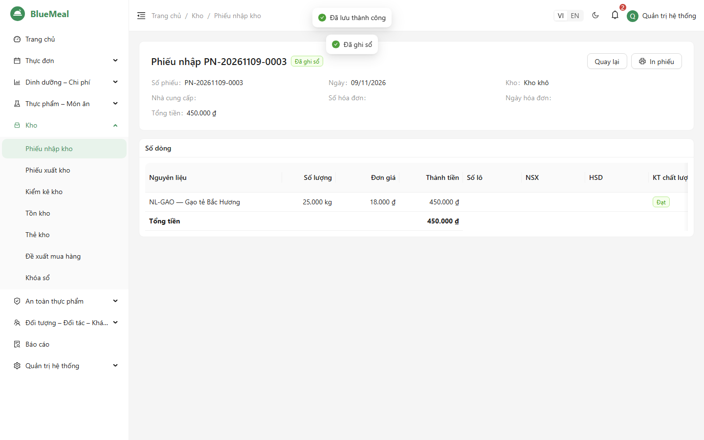
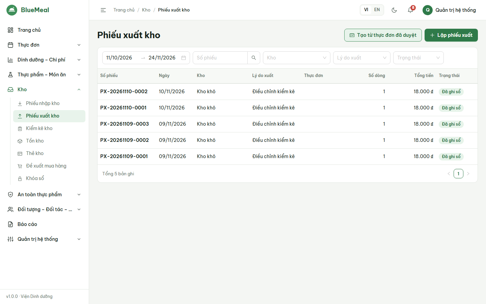
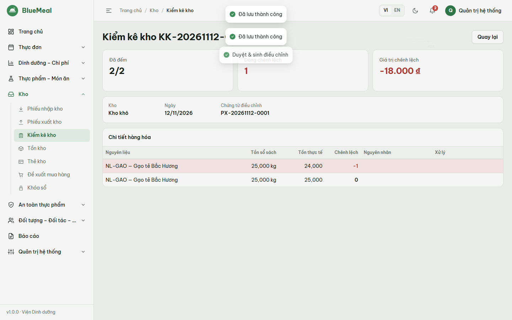
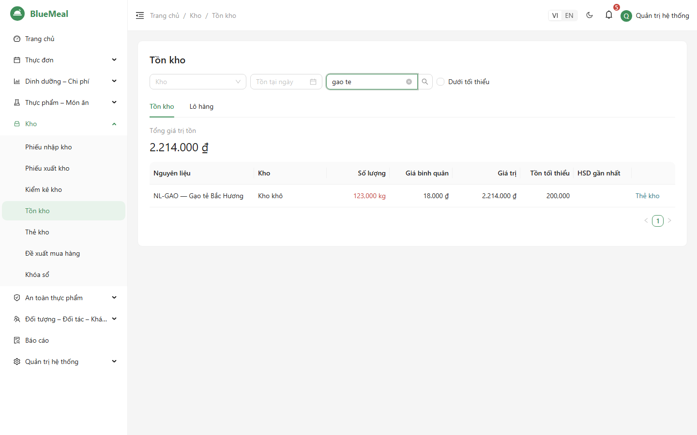
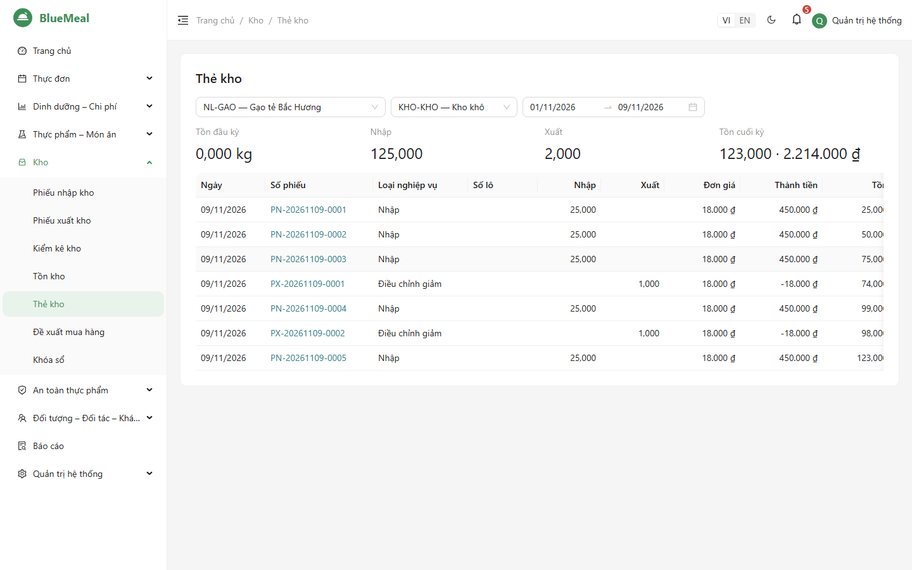
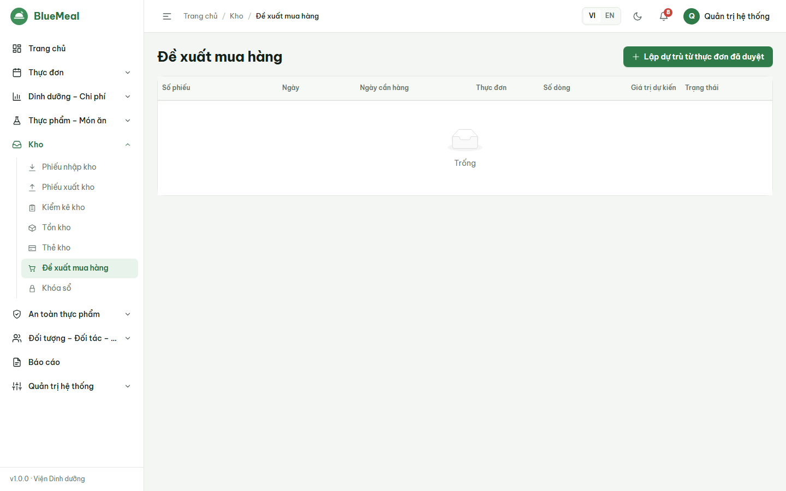
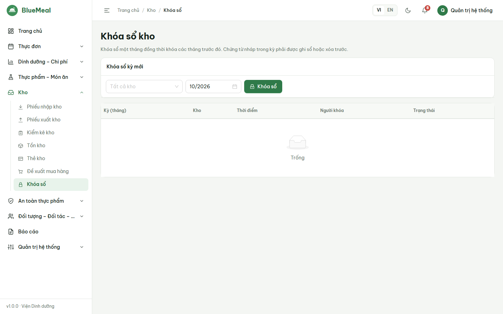

# HƯỚNG DẪN SỬ DỤNG — THỦ KHO (STOREKEEPER)

Đọc trước: [Phần chung](06_HDSD_00_ChungChoMoiNguoi.md). Thủ kho chỉ thấy **các kho được quản trị gán**.

## 1. Nguyên tắc

- Mọi biến động kho ghi vào **sổ cái**; chứng từ **đã ghi sổ không sửa/xóa được** — sai sót phải điều chỉnh bằng phiếu điều chỉnh hoặc kiểm kê.
- Số lượng tính theo **đơn vị mua** của nguyên liệu (kg, lít, hộp…).
- Giá xuất: **bình quân gia quyền di động** (mặc định) hoặc **FIFO theo lô** (do quản trị cấu hình). Không cho xuất vượt tồn (trừ khi quản trị cho phép).
- Mỗi lần nhập tạo một **lô** (số lô, NSX, HSD); xuất ưu tiên lô **hết hạn trước** (FEFO).
- Tháng đã **khóa sổ** (kế toán thực hiện) không ghi thêm chứng từ.

## 2. Nhập kho

1. *Kho → Phiếu nhập kho → Lập phiếu nhập* (hoặc từ *Đề xuất mua hàng → Tạo phiếu nhập*).
2. Chọn ngày, **kho**, nhà cung cấp, số/ngày hóa đơn.
3. Thêm dòng: chọn nguyên liệu (hoặc **quét/nhập mã vạch** vào ô mã vạch rồi Enter), số lượng, đơn giá, **số lô, NSX, HSD**, nhiệt độ khi nhận,
   **kết quả kiểm tra chất lượng** (Đạt / Đạt có điều kiện / Không đạt) — đây là bước 1 kiểm thực.
4. *Lưu* (nháp) hoặc *Ghi sổ* → xác nhận. **Dòng Không đạt chặn ghi sổ** — xóa dòng đó (trả nhà cung cấp) hoặc sửa kết quả.
5. *In phiếu*. Khi ghi sổ, biên bản kiểm thực bước 1 được tạo tự động cho từng dòng.

**Tồn đầu kỳ khi bắt đầu dùng hệ thống**: *Phiếu nhập kho → Nhập tồn đầu kỳ* → chọn ngày chứng từ và *Ghi sổ ngay* → *Tải file mẫu*, điền mã kho, mã nguyên liệu, số lượng (đơn vị mua), đơn giá, lô/NSX/HSD → chọn file → xem lỗi từng dòng → *Nhập*. Mỗi kho thành một phiếu nhập; kho nào có dòng lỗi sẽ không được nhập cho đến khi sửa file.

## 3. Xuất kho

- **Theo thực đơn**: *Phiếu xuất kho → Tạo từ thực đơn đã duyệt* (bếp trưởng có thể tạo trước) → kiểm tra số lượng, lô → *Ghi sổ*.
- **Thủ công**: *Lập phiếu xuất* → kho, lý do (Hủy, Trả nhà cung cấp, Chuyển kho, Khác) → thêm dòng → nút 💡 *Gợi ý lô (FEFO)* để tách dòng theo lô → *Ghi sổ*.
- **Chuyển kho**: lý do *Chuyển kho* + kho nhận → khi ghi sổ hệ thống tự lập và ghi sổ phiếu nhập ở kho nhận cùng giá vốn.
- Thông báo "Không đủ tồn kho" cho biết tồn hiện có và số cần xuất.

## 4. Kiểm kê (dùng được trên điện thoại)

1. *Kiểm kê kho → Tạo phiên kiểm kê*: kho, ngày, thành viên tổ kiểm kê (có thể chỉ chọn một số nguyên liệu).
2. Hệ thống chụp **tồn sổ sách theo lô**. Đi kiểm đếm, nhập **tồn thực tế** từng dòng (ô số lớn, dùng tốt trên điện thoại), ghi nguyên nhân/xử lý nếu chênh lệch; *Lưu số đếm* nhiều lần được.
   Hàng thực tế có mà sổ không có: *Thêm nguyên liệu phát sinh*.
3. Khi đã đếm đủ: *Duyệt & sinh điều chỉnh* → hệ thống **tự lập và ghi sổ** phiếu điều chỉnh tăng (thừa) / giảm (thiếu); tồn kho bằng số đếm.

## 5. Tồn kho, lô, thẻ kho

- *Tồn kho*: tồn hiện tại hoặc **tại một ngày** (chọn *Tồn tại ngày*), giá bình quân, giá trị, tồn tối thiểu, HSD gần nhất; lọc *Dưới tối thiểu*. Tab **Lô hàng**: lô sắp hết hạn trong N ngày (đỏ = đã hết hạn).
- *Thẻ kho*: chọn nguyên liệu, kho, khoảng ngày → tồn đầu kỳ, từng chứng từ nhập/xuất (bấm số phiếu để mở), tồn lũy kế, tồn cuối kỳ.

## 6. Đề xuất mua hàng

*Đề xuất mua hàng → Lập dự trù từ thực đơn đã duyệt*: chọn khoảng ngày (và kho) → hệ thống tính cho từng nguyên liệu: **Đề xuất = max(0, nhu cầu − tồn khả dụng + tồn tối thiểu)**,
tồn khả dụng đã trừ phiếu xuất dự kiến chưa ghi sổ. Sửa số lượng đặt, đơn giá dự kiến, nhà cung cấp → *Gửi duyệt* → người có quyền *Duyệt* → *Tạo phiếu nhập* (mỗi nhà cung cấp một phiếu nháp).

## 7. Khóa sổ cuối tháng

Khóa sổ do **kế toán** (người có quyền `stock.lock`) thực hiện. Việc của thủ kho trước khi khóa: ghi sổ hoặc xóa hết **chứng từ nháp** của tháng (hệ thống không cho khóa khi còn nháp),
hoàn tất kiểm kê cuối tháng. Sau khi khóa, tháng đó và các tháng trước không ghi thêm chứng từ được.

## 8. Báo cáo kho

RPT-01 Thống kê nhập/xuất · RPT-02 Nhập – xuất – tồn · RPT-03 Kiểm kê · RPT-04 Thẻ kho chi tiết · RPT-05 Hàng sắp hết hạn / dưới tối thiểu (menu *Báo cáo*, chọn báo cáo → *Xem báo cáo* → *Xuất Excel*).
